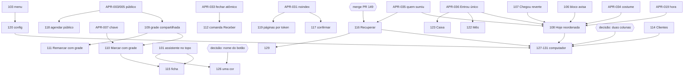
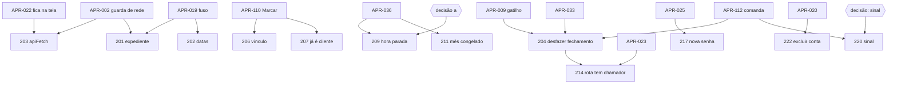
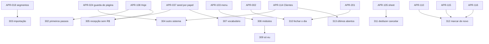
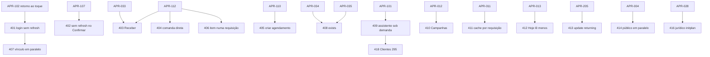
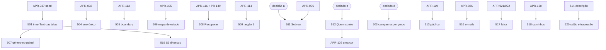
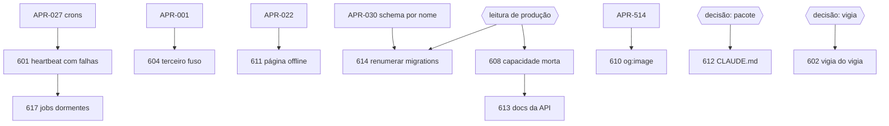

# 08 · Plano consolidado e tickets (Fase 7)

Contrato: `docs/97-PROMPT-APRIMORAMENTO-GERAL.md`, Parte C, Fase 7 (ondas, modelo de ticket, regras do plano) e Parte D (D1–D5). Base: `origin/main` em `33058dd0`, 13/10/2026.
Insumos: `01-diagnostico.md` a `07-geral.md` desta rodada (a lista da Onda U sai de `03-funcionalidade.md` §4); `agentes/` só onde faltou evidência; `CLAUDE.md` (um ticket, um commit; migrations; guarda vista reprovando). Caminhos de arquivo conferidos com `git ls-files` nesta fase.

**Esta fase não implementa nada.** Nenhum código, migration ou configuração foi alterado; nada foi commitado; produção não foi tocada.

**Como ler.**
- **ID:** `APR-0xx` = Onda U · `APR-1xx` = Onda 1 · `2xx` = Onda 2 … `6xx` = Onda 6. Entre parênteses, o ID de origem (F-01, C-07, I-10, D-02, G-05…), que leva à evidência nos documentos 01–07.
- **Esforço** (contrato): **P** ≤ 0,5 d (conto 0,25–0,5) · **M** 1–2 d · **G** 3–5 d.
- **Onda U:** cada ticket no modelo completo do contrato. **Ondas 1–6:** tabela compacta com as colunas essenciais (ID, origem, proposta, arquivos, aceite medido, teste, migration, dependências, esforço); risco, reversão e verificação em produção seguem a regra geral da §3, salvo nota na linha.
- Rótulos A3 continuam valendo: o que é **[HIPÓTESE]** ou **[NÃO VERIFICADO]** no diagnóstico continua assim aqui.

---

## 1 · Resumo em 10 linhas

1. São **160 tickets** em 7 ondas: U (37), Interface (31), Funcionalidade (22), Facilidade (13), Velocidade (18), Copy (20), Geral (19).
2. **Onda U primeiro**: 1 S0 reproduzido (agendar público grava outro dia, F-01), 1 S0 condicional (comanda nasce vazia e cobra o preço de hoje, C-01) e os S1 que travam, perdem dado, cobram errado, mostram número errado ou vazam dado.
3. O **1º ticket** é meia hora: o teste com data fixa que reprova todo dia desde 09/10 (APR-001). Sem ele, a CI vermelha esconde o próximo vermelho de verdade.
4. Dinheiro concentra o risco: comanda vazia (C-01), item em dobro (B-07), comanda fechada editável (C-14, E-04), fechamento pela metade (C-15), pacote fora do caixa (C-02, C-38, **bloqueado por decisão**).
5. Escala: Mês e Serviços **param de abrir** com ~220 comandas em 90 dias (B-00b); 7 números saem cortados em 1.000 linhas (E-02); a RLS por linha deixa Hoje e Agenda lentas com o histórico (E-01).
6. Quatro consertos de tela pegam mais de um defeito de uma vez: hora no fuso do negócio (C-07), fila offline que sai ao abrir e tem dono (C-45, C-46), folga que não derruba a tela (C-05) e convite que abre (C-37).
7. Esforço da Onda U: **31–59 dias** de trabalho (25–49 sem os 2 tickets do épico de pacote, que esperam decisão). Total das 7 ondas: **92,5–182 dias**; com 20–30% de integração e verificação, **111–237 dias** [HIPÓTESE: não há histórico de velocidade por ticket].
8. **Dá para começar hoje sem o Eduardo:** 33 dos 37 tickets da Onda U não dependem de decisão nem de produção (§11). O deploy, sim, depende de uma leitura de produção (migration `0102`).
9. **Do Eduardo**, em ordem de impacto: autorizar leitura de produção (0102, gatilho do cron de cobrança, mínimo de senha, região do banco), decidir o épico de pacote, "Sobrou × Lucro", nome do botão central, e2e fora × dentro da CI (§10).
10. Maiores riscos: mexer na RLS (E-01), mexer em dinheiro, migrations que colidem com os PRs #142 e #149, e guardas cegas. Cada um tem tratamento escrito (§12).

---

## 2 · Números

### 2.1 Tickets e esforço por onda

| Onda | Tickets | P | M | G | Esforço (dias) | Bloqueados por decisão ou produção |
| --- | --- | --- | --- | --- | --- | --- |
| **U · Urgente** | 37 | 16 | 18 | 3 | **31–59** | 4 (APR-016, 017 épico de pacote; parte de 026 e 036) |
| **1 · Interface** | 31 | 15 | 16 | 0 | **19,75–39,5** | 7 (I-02 e as 5 de duas colunas; 116 espera o PR #149) |
| **2 · Funcionalidade** | 22 | 18 | 4 | 0 | **8,5–17** | 3 (209, 214, 220) |
| **3 · Facilidade** | 13 | 5 | 8 | 0 | **9,25–18,5** | 0 (313 é opcional) |
| **4 · Velocidade** | 18 | 14 | 4 | 0 | **7,5–15** | 0 |
| **5 · Copy** | 20 | 17 | 3 | 0 | **7,25–14,5** | 4 (503, 511, 512, 516) |
| **6 · Geral** | 19 | 13 | 6 | 0 | **9,25–18,5** | 6 (602, 608, 612, 614, 618, 619) |
| **Soma** | **160** | 98 | 59 | 3 | **92,5–182** | 24 |
| **Com 20–30% de integração, verificação e revisão** | | | | | **111–237** | |

Conta: P = 0,25–0,5 d; M = 1–2 d; G = 3–5 d. Faixa baixa × 1,2 e faixa alta × 1,3. A faixa é larga de propósito: o contrato pede faixa, e não existe medida de quanto um ticket desta base leva (o `verify` local sozinho leva 10 min 12 s de build neste Windows, `01-diagnostico.md` §1).

### 2.2 O que entra na Onda U (regra usada)

O contrato tem duas frases sobre a Onda U: a A0 ("defeito que trava, perde dado, cobra errado, mostra número errado ou vaza dado sobe para uma onda de correções urgentes") e a Fase 7 ("todo S0 e os S1 que travam, perdem dado, cobram errado ou mostram número errado"). A A0 é mais larga e vem primeiro. Regra aplicada:

1. **Todo S0** e **todo S1** da lista de `03-funcionalidade.md` §4 (F-01, C-01, E-04, C-04, F-02, B-00b, C-02, C-38, C-03, E-02, E-03, C-05, C-07, C-45, C-48, C-37, C-39, F-03, F-05, C-36, E-01, C-06, 0102).
2. **S2 que gravam, cobram errado ou vazam dado** (A0): B-07 e C-12 (item em dobro), C-14 (dinheiro muda depois de fechado), C-15 (fecha pela metade), C-24 (nome volta depois de eliminação LGPD), C-46 (fila de outra pessoa enviada), G-05 (link com nome e horário indexável), N-01 (Recuperar cai inteiro).
3. **S2 que só mostram número divergente** entram na U **apenas** quando são pré-requisito de tela redesenhada na Onda 1: A-05 ("100% abaixo" de manhã), E-06 ("em risco" da Hoje ≠ Recuperar), C-26 (R$ 100 / 95 / 90 para o mesmo atendimento). Os demais (C-25, E-13, E-14, C-49) ficam na Onda 2.
4. **Habilitadores sem os quais o aceite da Onda U não se mede:** `conferir-schema-prod` por nome (C-27, para checar a `0102` antes do deploy), seed de dia cheio com um login por papel (G-60: o teste por papel de E-04 e os números de C-26 precisam dele) e a conferência de que dado de saúde não vai para o modelo (G-07, regra inviolável 9).
5. **Não entraram**, com motivo: D-01 e D-02 (S1 de copy, promessa de plano; vão para o topo da Onda 5, não cobram nem gravam errado); F-04 (S1 de copy pública; vai no ticket da tela de agendar, APR-118, depois dos consertos da U no mesmo arquivo); C-13 (toque engolido; o 2º toque fecha; vai com o redesenho da comanda, APR-112).

---

## 3 · Regras do plano (valem para todo ticket)

1. **Um ticket, um commit**, mensagem em português no formato `tipo(escopo): descrição (APR-XXX)` (`CLAUDE.md`, regra 12).
2. **Cada ticket cabe num `pnpm verify` verde.** Quando uma guarda nova reprova código que existe hoje (ex.: APR-002), a guarda e o conserto vão **no mesmo commit**, senão o `verify` fica vermelho.
3. **Guarda vista reprovando**, pelo procedimento do `CLAUDE.md`: commitar antes de mutar; reintroduzir **cada** defeito um por vez; confirmar que a mutação foi aplicada; a guarda grita se o padrão parar de casar (piso = o positivo conhecido). Casar com o que **muda** quando o defeito volta (a chamada, a frase inteira), nunca com nome que aparece em `import`, rótulo ou comentário.
4. **Testes de tela** (corrida, toque, fuso, rede) rodam com Playwright **fora do repositório** (`C:\temp\ciclo-medicao`, decisão de 31/08); o roteiro fica versionado como `.txt` em `docs/98-aprimoramento/medidas/` (G-21, APR-603). "Ver reprovar" = rodar o roteiro contra o código anterior ao ticket.
5. **Migrations:** aditiva **antes** do deploy; equivalente (troca de política com a mesma semântica) **junto** do deploy, com `pnpm test:rls` antes e depois; restritiva (`revoke`, gatilho que recusa) **depois** do deploy do código que deixa de precisar do privilégio (memória "migration que tira privilégio inverte a ordem"). **Numeração:** definida no commit, depois de rebasear no `main`; **nunca 0118** enquanto o PR #149 estiver aberto, e conferir a 0101 do PR #142 (G-58, APR-614).
6. **Nenhum deploy** antes de o Eduardo confirmar (só leitura) que a `0102` está em `schema_migrations` de produção (`tenant.ts:89` lê `professions(vocab, pacote)` em toda requisição; sem a coluna, todo login cai).
7. **Medir com build de produção** (`pnpm build` + `pnpm start`), mediana e pior de 5, com a máquina livre (os tempos da Fase 0 foram medidos com CPU em 94–99%).
8. **Risco e reversão (regra geral das ondas 1–6):** todo ticket sem migration reverte com `git revert` do commit. Ticket com migration diz na linha como desfazer.
9. **Verificação em produção (regra geral):** sempre **com autorização escrita do Eduardo e só leitura**: abrir a tela com a conta de teste dele ou ler logs da Vercel/Supabase. Nunca criar dado em produção.
10. **Não atropelar:** o PR #149 (Recuperar, venda de balcão, migration 0118) e o `docs/95`/`96` (fila de chamadas) mexem em `recuperar.tsx` e no estoque. Tickets nesses arquivos esperam o merge (marcados na coluna de dependências).

---

## 4 · Onda U · Urgente (modelo completo)

Ordem dentro da onda: a numeração **não** é a ordem de execução; a ordem está na §11.

### APR-001 · Consertar o teste com data fixa que reprova todo dia

**Onda:** U · **Severidade:** S1 (processo) · **Esforço:** P (0,25 d) · **Dimensão:** geral (testes)
**Problema (com evidência):** `tests/integration/legal-casos-estado.test.ts:21` fixa `HOJE = '2026-10-08'` e a coluna `opened_on` usa `default current_date`; `tests/integration/legal-captura.test.ts:25` tem o mesmo padrão. Desde 09/10, 2 falhas determinísticas (FATO, C-36). O último CI do `main` foi verde em 08/10; o próximo push no `main` reprova (conferido no GitHub em 13/10, `01-diagnostico.md` §7). Origem: C-36, G-19.
**Proposta:** calcular `HOJE` com `hojeNoFuso(tz, new Date())` (o mesmo helper do produto) ou inserir `opened_on: HOJE` explicitamente no teste. Não muda código do produto.
**Telas/rotas:** nenhuma. **Arquivos prováveis:** `tests/integration/legal-casos-estado.test.ts`, `tests/integration/legal-captura.test.ts`.
**Critério de aceite (MEDIDO):** os dois arquivos verdes em 5 rodadas seguidas em série, num dia D **e** de novo no dia D+1 (prova de que não depende da data); `pnpm test:integration` sem nenhuma falha por data.
**Teste:** o próprio teste. Ver reprovar: hoje ele já reprova (o defeito está plantado); depois do conserto, trocar o cálculo de volta para o literal e ver as 2 falhas voltarem.
**Migration:** não. **Dependências:** nenhuma (1º da fila).
**Risco e como reverter:** baixo; `git revert`.
**Como verificar em produção depois:** não toca produção; conferir que o próximo CI do `main` no GitHub fica verde.
**Commit:** `test(legal): calcular a data de hoje no fuso em vez de fixar 08/10 (APR-001)`

### APR-002 · Impedir que a folga derrube a tela quando a rede pisca (e ampliar a guarda para onde o defeito mora)

**Onda:** U · **Severidade:** S1 · **Esforço:** P (0,5 d) · **Dimensão:** funcionalidade
**Problema:** em Configurações › Horários, com a rede da rota `/api/v1/time-off` cortada, "Adicionar" leva a **tela inteira** ao boundary e o motivo digitado some (**reproduzido**, `capturas/fase2-C05-folga-rede-caiu-390.png`). Causa: `await fetch` sem `try` dentro de `useTransition` em `src/components/config/editor-expediente.tsx:134-148`. A guarda `tests/unit/design/rede-nao-derruba-tela.test.ts:80` só varre `src/app`: guarda cega de raiz. Origem: C-05, G-20.
**Proposta:** (1) `try/catch` na transição, toast com o motivo, sem limpar o formulário; (2) a guarda passa a varrer `src/app`, `src/components` e `src/lib`, com **piso de arquivos por raiz** (se uma raiz vier com 0 arquivos, reprova). Guarda e conserto no mesmo commit, porque a guarda ampliada reprova hoje neste arquivo.
**Telas/rotas:** `/admin/config/horarios`, `/admin/config/profissionais/[id]`. **Arquivos prováveis:** `src/components/config/editor-expediente.tsx`, `tests/unit/design/rede-nao-derruba-tela.test.ts`.
**Critério de aceite (MEDIDO):** roteiro `fase2-reproducoes.mjs.txt` parte `c05` (rede cortada, motivo digitado, "Adicionar"): 5 de 5 rodadas ficam na tela, com toast de erro e o motivo ainda no campo; 0 de 5 no boundary.
**Teste:** caminho feliz (folga salva) + erro (rede cortada) no roteiro; a guarda ampliada **vista reprovando** neste arquivo antes do conserto (controle positivo pronto no relatório C) e reprovando quando se zera a lista de arquivos de uma raiz.
**Migration:** não. **Dependências:** nenhuma.
**Risco e como reverter:** baixo; `git revert`. A guarda pode achar outros arquivos em `src/components`/`src/lib`: se achar, eles entram na linha de base "só encolhe" com o nome, não são ignorados.
**Como verificar em produção depois:** com autorização, abrir Horários na conta de teste, modo avião no celular, tentar adicionar folga: a tela fica e avisa.
**Commit:** `fix(horarios): folga sem rede avisa em vez de derrubar a tela; guarda varre components e lib (APR-002)`

### APR-003 · Fazer a página pública gravar o dia e a hora que a tela mostra

**Onda:** U · **Severidade:** **S0** · **Esforço:** M (1,5–2 d) · **Dimensão:** funcionalidade
**Problema:** a página de agendar grava **outro dia** (às vezes outro profissional) do que a tela mostra. Reproduzido 2 de 6 em uso natural e 3 de 3 com a 2ª consulta segurada; 3 agendamentos errados conferidos no banco local (todos "Tue 13/10 09:00" com a tela dizendo qui 15 / sáb 17 / dom 18). Causa: `src/app/(public)/[slug]/agendar/agendar.tsx:448-501` grava `setSlots` depois do `await` sem descartar resposta velha; o resumo (`:1202-1208`) e o sucesso (`:703-710`) montam o dia com `dia` e a hora com `slotEscolhido.startsAt`. Origem: F-01.
**Proposta:** (1) contador de requisição (ou `AbortController`): só a resposta da consulta **mais recente** escreve a lista; (2) zerar `slotEscolhido` quando a lista muda; (3) trocar de dia limpa a lista e mostra esqueleto até a resposta **daquele** dia; (4) dia **e** hora do resumo e do sucesso tirados de `slotEscolhido.startsAt` no fuso do negócio, por uma função pura nova em `src/core/agenda/` ("resumo a partir do horário").
**Telas/rotas:** `/[slug]/agendar`. **Arquivos prováveis:** `src/app/(public)/[slug]/agendar/agendar.tsx`, função nova em `src/core/agenda/`, teste unitário dela.
**Critério de aceite (MEDIDO):** roteiro `F-corrida-dia.mjs` (2ª consulta segurada 2,5 s), **20 repetições** no perfil celular 4×/4G lenta → **0 divergências** entre o dia/hora do sucesso e o `starts_at` gravado no banco local, lido no fuso do negócio.
**Teste:** unitário da função pura (horário às 23:30 UTC vira o dia certo em São Paulo; troca de dia não muda o resumo de um horário já escolhido) + roteiro de corrida. Ver reprovar: o roteiro contra o código atual dá 3 de 3 divergências (FATO); a unitária reprova se o resumo usar `dia` em vez do horário.
**Migration:** não. **Dependências:** nenhuma. Vem antes de APR-004, 005, 109 e 118 (mesmo arquivo).
**Risco e como reverter:** médio: é a página que fala em nome do negócio. Componente isolado; `git revert`. Não refatorar o arquivo inteiro (1.356 linhas, G-27): extrair só a função do resumo.
**Como verificar em produção depois:** com autorização, na conta de teste do Eduardo, marcar 3 horários trocando de dia rápido no celular dele e conferir na Agenda que caíram no dia mostrado; depois cancelar.
**Commit:** `fix(agendar-publico): só a resposta mais recente de horários vale e o resumo sai do horário escolhido (APR-003)`

### APR-004 · Fazer o reenvio do agendamento público não virar "já reservado" para o próprio horário

**Onda:** U · **Severidade:** S1 · **Esforço:** M (1 d) · **Dimensão:** funcionalidade
**Problema:** dois `POST /api/v1/public/demo-dom-estilo/book` com o mesmo corpo (resposta do 1º perdida, cliente toca de novo): 1º → 200; 2º → **409 `SLOT_TAKEN` "Esse horário acabou de ser reservado."** para o horário que ela mesma marcou (**reproduzido**, `medidas/fase2-reproducoes.json` → `c04`). A rota não usa `comIdempotencia`; o cliente não manda `Idempotency-Key` (`agendar.tsx:607-654`). O texto do `catch` sem rede diz que o horário "aparece" quando na verdade some (F-19). Origem: C-04, F-19.
**Proposta:** chave por **intenção** (gerada uma vez quando o pedido é montado, guardada no estado, reenviada até o corpo mudar); a rota usa `comIdempotencia` por tenant; em `SLOT_TAKEN`, se o agendamento daquele horário tem o mesmo `phone_hash`, devolver sucesso com o mesmo id. Texto do `catch`: "Não consegui falar com o servidor. Se o pedido chegou, este horário sai da lista. Toque em Pedir de novo: não vai duplicar." (`06-copy.md` §1.2).
**Telas/rotas:** `/[slug]/agendar`, `POST /api/v1/public/[slug]/book`. **Arquivos prováveis:** `src/app/api/v1/public/[slug]/book/route.ts`, `src/app/(public)/[slug]/agendar/agendar.tsx`, `src/server/services/public-booking.ts` (busca por `phone_hash`).
**Critério de aceite (MEDIDO):** integração: mesma chave 2× → **1** agendamento e a **mesma** resposta (status e id); sem chave, mesmo telefone e mesmo horário → 200 com o mesmo id; telefone diferente no mesmo horário → 409.
**Teste:** integração com os 3 casos (feliz, reenvio, outra pessoa). Ver reprovar: retirar a checagem de `phone_hash` e ver o caso "reenvio sem chave" dar 409; retirar `comIdempotencia` e ver o caso "mesma chave" criar 2.
**Migration:** não. **Dependências:** APR-003 (mesmo arquivo do cliente).
**Risco e como reverter:** baixo; `git revert`. Cuidado: a resposta de sucesso por `phone_hash` não pode revelar dado de outra pessoa (só devolve quando o hash bate).
**Como verificar em produção depois:** com autorização, nos logs da Vercel, contar 409 `SLOT_TAKEN` seguidos de 200 do mesmo IP no mesmo minuto antes × depois.
**Commit:** `fix(agendar-publico): reenvio do mesmo pedido devolve o mesmo horário em vez de 409 (APR-004)`

### APR-005 · Manter o aviso de horário tomado na tela, com alternativas

**Onda:** U · **Severidade:** S1 · **Esforço:** P (0,5 d) · **Dimensão:** funcionalidade
**Problema:** quando outra pessoa marca o horário entre a escolha e o envio (409), o aviso é **apagado no mesmo instante** e o formulário some, sem alternativas (FATO: `agendar.tsx:634-637` chama `buscarDisponibilidade(dia)`, que faz `setErro(null)` em `:456`; `capturas/F-agendar-ocupado-celular.png`). A API já devolve `details.alternatives`. Origem: F-02.
**Proposta:** recarregar a lista **sem** limpar o erro; mostrar até 3 alternativas tocáveis vindas de `details.alternatives`; manter nome e telefone; rolar até o aviso e pôr o foco nele (correção medida no protótipo, `02-interface.md` §5). Texto: "Esse horário acabou de ser marcado por outra pessoa. Seu nome e telefone continuam aqui. Estes estão livres, perto do que você queria:" (`06-copy.md` §1.1).
**Telas/rotas:** `/[slug]/agendar`. **Arquivos prováveis:** `src/app/(public)/[slug]/agendar/agendar.tsx`.
**Critério de aceite (MEDIDO):** roteiro `F-agendar.mjs … ocupado`: depois do 409, o texto "acabou de ser marcado" continua visível **3 s depois** e há **≥ 1** alternativa tocável; nome e telefone continuam preenchidos; tocar a alternativa e enviar grava aquele horário.
**Teste:** roteiro (feliz: alternativa escolhida grava; erro: 409 sem alternativas mostra "Escolha outro dia"). Ver reprovar: contra o código atual o roteiro registra `alertas: []` (FATO do agente F).
**Migration:** não. **Dependências:** APR-003, APR-004 (mesmo arquivo; o 409 do próprio reenvio deixa de existir).
**Risco e como reverter:** baixo; `git revert`.
**Como verificar em produção depois:** com autorização, na conta de teste, marcar o mesmo horário em dois celulares ao mesmo tempo: o segundo vê o aviso e as alternativas.
**Commit:** `fix(agendar-publico): aviso de horário tomado fica na tela e oferece alternativas (APR-005)`

### APR-006 · Abrir a comanda já com o serviço e o preço combinados

**Onda:** U · **Severidade:** **S0 condicional** (cobra errado) · **Esforço:** M (1,5–2 d) · **Dimensão:** funcionalidade
**Problema:** concluir o horário "Corte + barba · R$ 70,00" abre a comanda **vazia**, com "Barba · R$ 35,00" pré-escolhido (**reproduzido**, `capturas/fase2-C01-comanda-nasce-vazia-390.png`). Ao lançar, o preço é o de **hoje**, não o combinado: `src/server/services/agendamentos.ts:744-751` cria o ticket sem item; `src/app/admin/comanda/[id]/comanda.tsx:63` pré-escolhe `servicos[0]`; `comanda.tsx:91-101` não manda `unitPriceCents`; `src/server/services/comanda.ts:119` usa `?? servico.price_cents`; o preço combinado está congelado em `agendamentos.ts:367`. Origem: C-01.
**Proposta:** ao concluir, criar a comanda **com** o item do agendamento (`service_id`, `appointment.price_cents`) na mesma função; comanda já existente não ganha item duplicado (o `23505` já é tratado); na tela, pré-selecionar o serviço do agendamento quando a comanda estiver vazia por outro motivo.
**Telas/rotas:** `/admin/agenda` (sheet, "Concluir"), `/admin/comanda/[id]`. **Arquivos prováveis:** `src/server/services/agendamentos.ts`, `src/server/services/comanda.ts`, `src/app/admin/comanda/[id]/comanda.tsx`.
**Critério de aceite (MEDIDO):** integração: agendar a R$ 45 → subir o serviço para R$ 50 → concluir → comanda com **1 item de R$ 45**; concluir duas vezes (reenvio) → continua **1** item. Roteiro de tela: concluir "Corte + barba R$ 70" mostra a comanda com o item de R$ 70 na 1ª renderização.
**Teste:** integração (feliz + reenvio + agendamento sem serviço, que abre vazia sem pré-escolha arbitrária). Ver reprovar: mutação voltando a `servico.price_cents` reprova o caso de R$ 45; tirar a criação do item reprova o caso feliz.
**Migration:** não. **Dependências:** nenhuma. Vem antes de APR-007, 008, 033, 112.
**Risco e como reverter:** alto (dinheiro). Ordem "conclui → cria comanda com item" dentro da mesma função; sem resposta otimista. `git revert` volta ao comportamento antigo sem perder dado (o item criado é um `ticket_item` normal).
**Como verificar em produção depois:** com autorização, na conta de teste, concluir um horário com preço alterado depois de marcado e conferir o item; ler no banco (só leitura) que `ticket_items.unit_price_cents` = `appointments.price_cents` nos atendimentos do dia.
**Commit:** `fix(comanda): concluir o atendimento abre a comanda com o serviço e o preço combinados (APR-006)`

### APR-007 · Gerar a chave de idempotência por intenção nos formulários que gravam

**Onda:** U · **Severidade:** S2 elevado pela A0 (cobra errado) · **Esforço:** M (1 d) · **Dimensão:** funcionalidade
**Problema:** dois "Adicionar item" que escapam da trava gravam **2 itens** (FATO: `B-duplo-api.mjs`, 200, 200, 2 itens). A chave nasce **dentro** do handler de envio, então cada toque é um pedido novo: `src/app/admin/comanda/[id]/comanda.tsx:28`, `src/app/admin/agenda/novo/formulario.tsx:166`, `src/app/admin/agenda/detalhe.tsx:42`, `src/app/admin/clientes/nova/formulario.tsx:51`. Com rede lenta, o reenvio de "Marcar" dá 409 para o próprio horário (C-12). Origem: B-07, C-12.
**Proposta:** a chave nasce quando o corpo é montado e é reusada até o corpo mudar (um pequeno hook em `src/lib/`), nos 4 formulários. **Não** deduplicar item por conteúdo: dois itens iguais podem ser legítimos (`03` §5).
**Telas/rotas:** comanda, agenda/novo, detalhe do horário, clientes/nova. **Arquivos prováveis:** os 4 acima + hook novo em `src/lib/` + guarda em `tests/unit/design/`.
**Critério de aceite (MEDIDO):** integração: 2 POSTs de item com a **mesma** chave → **1** item; roteiro com duplo toque em "Adicionar item" no celular 4× → 1 item em 5 de 5.
**Teste:** integração (feliz: chaves diferentes para intenções diferentes geram 2 itens; reenvio: mesma chave gera 1). Guarda "`randomUUID()` não aparece dentro da função de envio" casando a **chamada dentro do corpo da função** (delimitada pelo fim real da função, não por janela de caracteres), com controle positivo plantado; vista reprovando nos 4 arquivos antes do conserto.
**Migration:** não. **Dependências:** APR-006 (mesmo arquivo da comanda).
**Risco e como reverter:** baixo; `git revert`. Cuidado: chave que não muda quando o corpo muda faria o servidor devolver a resposta antiga ("Essa operação já foi enviada com outro conteúdo"); o hook troca a chave a cada mudança de corpo.
**Como verificar em produção depois:** com autorização, ler (só leitura) se existem `ticket_items` iguais criados com < 2 s de diferença na mesma comanda, antes × depois.
**Commit:** `fix(formularios): chave de idempotência nasce com o pedido e não a cada toque (APR-007)`

### APR-008 · Recusar item e desconto em comanda já fechada

**Onda:** U · **Severidade:** S2 elevado pela A0 (cobra errado) · **Esforço:** P (0,5 d) · **Dimensão:** funcionalidade
**Problema:** a recepção fecha; o profissional, em outro aparelho, lança item ou desconto: entra em comanda **fechada** e o `total_cents` muda depois de congelar taxa e comissão. `src/server/services/comanda.ts:212-240` lê o `status` e grava com `.eq('id')` só; `recalcularSubtotal` sem guarda. Origem: C-14.
**Proposta:** `.eq('status', 'open')` no `UPDATE`/`INSERT` de item e desconto + **contar linhas** (lição "update de zero linhas não é erro"): 0 linha → 409 "Esta comanda já foi fechada. Atualize a tela."
**Telas/rotas:** `/admin/comanda/[id]`; `POST/PATCH /api/v1/tickets/[id]/items`. **Arquivos prováveis:** `src/server/services/comanda.ts`, `src/app/api/v1/tickets/[id]/items/route.ts`, `src/app/api/v1/tickets/[id]/items/[itemId]/route.ts`.
**Critério de aceite (MEDIDO):** integração: fechar, depois `adicionarItemComanda` → **409** e `total_cents` **igual** ao do fechamento; desconto depois de fechar → 409.
**Teste:** integração (feliz: comanda aberta aceita; erro: fechada recusa). Ver reprovar: tirar o `.eq('status','open')` e ver o total mudar.
**Migration:** não (o gatilho no banco é a APR-009). **Dependências:** APR-006.
**Risco e como reverter:** médio (dinheiro); `git revert`.
**Como verificar em produção depois:** com autorização, ler (só leitura) comandas com `ticket_items.created_at > tickets.closed_at`: deve ser 0 para itens novos depois do deploy.
**Commit:** `fix(comanda): comanda fechada recusa item e desconto novos (APR-008)`

### APR-009 · Congelar no banco o dinheiro da comanda fechada e tirar o DELETE de comanda

**Onda:** U · **Severidade:** S1 · **Esforço:** M (1,5–2 d) · **Dimensão:** funcionalidade (segurança)
**Problema:** qualquer membro, pelo REST com o próprio JWT, edita `ticket_items.commission_cents` de comanda fechada e apaga `tickets`: políticas `tickets_delete`, `tickets_update`, `ticket_items_update`, `ticket_items_delete` = `has_tenant(tenant_id)` e **0 gatilhos** (FATO, `pg_policies` e `pg_trigger` no banco local). A `0073` justifica com premissa falsa ("rotas usam service_role"; `close/route.ts:22` usa o cliente do usuário). Execução por um profissional [NÃO VERIFICADO]: o seed não tem login de profissional (destrava com APR-037). Origem: E-04, G-01, G-55.
**Proposta:** migration nova: (1) `drop policy tickets_delete` + `revoke delete on tickets from authenticated` (regra 11: nada se apaga; estorno é compensação); (2) gatilho `before update or delete` que recusa mudança de colunas de dinheiro (`*_cents`, forma de pagamento) em `closed`/`paid` e recusa DELETE de item fora de `open`, **deixando passar** a transição de estorno pela rota `POST /tickets/[id]/cancel`; (3) o cabeçalho da migration nova registra que a premissa da `0073` estava errada (não editar a 0073, que já foi aplicada).
**Telas/rotas:** nenhuma visível; API de comanda. **Arquivos prováveis:** `supabase/migrations/<próximo número>_comanda_fechada_congelada.sql`, `tests/rls/` (caso por papel).
**Critério de aceite (MEDIDO):** `pnpm test:rls` por papel: profissional → `PATCH ticket_items.commission_cents` de comanda fechada → **42501** (ou erro do gatilho com código próprio, para não confundir com privilégio: memória "SQLSTATE 42501 é ambíguo"); `DELETE tickets` → negado; estorno pela rota → passa; fluxo normal (abrir, lançar, fechar) → passa.
**Teste:** RLS por papel com os 4 casos. Ver reprovar **antes** do gatilho (hoje os dois primeiros casos passam). Controle positivo: dono fechando comanda aberta continua passando.
**Migration:** **restritiva, depois do deploy** de APR-006, 007, 008 e 033 (o código não pode mais depender de editar comanda fechada).
**Dependências:** APR-008, APR-033, APR-037 (login de profissional no seed, para o teste por papel na tela).
**Risco e como reverter:** médio: pode quebrar fluxo legítimo que ninguém mapeou (estorno C-41 é o conhecido). Reverter: migration compensatória que recria a política e derruba o gatilho (escrita junto, não aplicada).
**Como verificar em produção depois:** com autorização, só leitura: `pg_policies` e `pg_trigger` de `tickets`/`ticket_items` iguais aos do local; nenhum erro novo de gatilho nos logs do Supabase em 48 h de uso normal.
**Commit:** `fix(banco): congelar dinheiro de comanda fechada e retirar o DELETE de comanda (APR-009)`

### APR-010 · Fazer Mês e Serviços abrirem com muitas comandas

**Onda:** U · **Severidade:** S1 (trava) · **Esforço:** P (0,5 d) · **Dimensão:** funcionalidade (velocidade)
**Problema:** com ~220 comandas fechadas em 90 dias, `/admin/mes` e `/admin/config/servicos` caem em "Não consegui carregar esta tela" (HTTP 414 no gateway: a URL estoura). Causa: `.in('ticket_id', ids)` em `src/server/services/caixa.ts:265-276` (`margemDosServicos`); `src/app/admin/mes/page.tsx:95` sem `catch` (FATO: reprodução com 230 comandas, `B-repro-414.sh`; limite 200 ✓ / 220 ✗). O próprio `caixa.ts:197-208` (`concentracaoDoMes`) já trocou esse padrão por join. Origem: B-00b, E-05.
**Proposta:** filtrar `ticket_items` por `tickets!inner(status, closed_at)` como em `concentracaoDoMes`; na página, o bloco que falha mostra "Não consegui carregar isto" e o resto da tela abre (I-04).
**Telas/rotas:** `/admin/mes`, `/admin/config/servicos`. **Arquivos prováveis:** `src/server/services/caixa.ts`, `src/app/admin/mes/page.tsx`, `src/app/admin/config/servicos/page.tsx`.
**Critério de aceite (MEDIDO):** integração com **250** comandas fechadas em 90 dias → `margemDosServicos` devolve o mesmo resultado que a soma feita no banco; `B-repro-414.sh` + `B-repro-414-ver.mjs` → **200** nas duas telas.
**Teste:** integração (feliz com 250; vazio com 0 comandas). Ver reprovar: rodar a integração contra o código atual (414/erro).
**Migration:** não. **Dependências:** nenhuma.
**Risco e como reverter:** baixo; `git revert`.
**Como verificar em produção depois:** com autorização, abrir Mês e Serviços na conta de teste; ler nos logs da Vercel se houve 414/500 nessas rotas nos 7 dias anteriores (mede se já atingiu alguém).
**Commit:** `fix(caixa): margem dos serviços filtra por join e não por lista de ids na URL (APR-010)`

### APR-011 · Tirar a lista de ids da URL no Recuperar e travar o padrão com uma guarda

**Onda:** U · **Severidade:** S2 latente, elevado (trava a tela inteira) · **Esforço:** P (0,5 d) · **Dimensão:** funcionalidade
**Problema:** `comNotas` monta `.in('client_id', <até 200 ids>)` (`src/server/services/notas-do-cliente.ts:79-83`; teto `LIMITE_PADRAO = 200` em `recuperar-receita.ts:49`); o 414 começa em ~210–220 ids no gateway local. O erro vira `AppError('INTERNAL')` e `src/app/admin/recuperar/page.tsx:127` espera sem `catch`: a tela inteira cai [INFERÊNCIA: limite medido + código]. Origem: N-01.
**Proposta:** filtrar `client_scores` por join/RPC com o mesmo recorte da lista, sem lista de ids; ou lotes de 100. Guarda nova: "nenhum `.in(` com lista sem teto em `src/server`", com a lista dos que têm teto e o motivo (`crm.ts:464`, `importacao-clientes.ts:274`, `orcamentos.ts:283`, `quem-ja-atendo.ts:185`).
**Telas/rotas:** `/admin/recuperar`. **Arquivos prováveis:** `src/server/services/notas-do-cliente.ts`, `src/app/admin/recuperar/page.tsx`, guarda em `tests/unit/`.
**Critério de aceite (MEDIDO):** integração com **250** pessoas na lista → a página abre (200) e as notas aparecem; guarda verde.
**Teste:** integração + guarda. Ver reprovar: a guarda reprova em `caixa.ts` (antes de APR-010) e em `notas-do-cliente.ts` (antes deste) — esses dois são o **piso** (positivos conhecidos); se o detector parar de achar `.in(` em `src/server`, a guarda grita.
**Migration:** não (ou aditiva antes, se virar RPC). **Dependências:** APR-010 (para a guarda passar). O arquivo `recuperar/page.tsx` também é tocado pelo PR #149: mexer só na linha do `comNotas`.
**Risco e como reverter:** baixo; `git revert`.
**Como verificar em produção depois:** com autorização, contar (só leitura) quantos tenants têm > 150 pessoas na lista do Recuperar: diz quão perto o defeito estava.
**Commit:** `fix(recuperar): notas sem lista de ids na URL e guarda contra .in sem teto (APR-011)`

### APR-012 · Parar de cortar em 1.000 linhas os números de atribuição e campanhas (parte 1 de 2)

**Onda:** U · **Severidade:** S1 (número errado) · **Esforço:** M (1,5–2 d) · **Dimensão:** funcionalidade
**Problema:** `supabase/config.toml:18` tem `max_rows = 1000`; 7 consultas passam disso e **saem cortadas sem aviso**. Nesta parte: `src/server/services/atribuicao.ts:142,150,237` ("o Motor trouxe", `receitaPorCampanha`). Não reproduzido com login (o tenant de 10 mil linhas não tem membro); FATO de código e de config. Origem: E-02.
**Proposta:** agregados em RPC com `group by` no banco (migration aditiva); listas que precisam de linhas usam `buscarTudoPaginado` com `order`. Guarda nova "consulta sem teto em tabela que cresce", com **linha de base que só encolhe**: os 7 lugares conhecidos entram nominalmente e este ticket tira 3.
**Telas/rotas:** `/admin/hoje` (card do Motor), `/admin/campanhas`, `/admin/mes`. **Arquivos prováveis:** `src/server/services/atribuicao.ts`, `supabase/migrations/<próximo>_atribuicao_agregada.sql`, guarda em `tests/unit/`.
**Critério de aceite (MEDIDO):** integração com **1.200** atendimentos `done` atribuíveis num tenant → o número da função = `count`/`sum` calculado direto no banco.
**Teste:** integração (1.200 linhas; e 0 linhas → zero com o cenário montado, não lista vazia por acaso). Guarda vista reprovando: devolver uma das 3 consultas à forma antiga.
**Migration:** **aditiva, antes do deploy** (RPC nova `security invoker`, com `grant execute` só para `authenticated`). **Dependências:** APR-037 (seed com volume ajuda a medir; não bloqueia o teste de integração).
**Risco e como reverter:** médio: RPC nova precisa respeitar a RLS (`security invoker`). Reverter: código volta para a consulta antiga; a RPC fica sem uso (não precisa apagar).
**Como verificar em produção depois:** com autorização, só leitura: quantos tenants têm > 1.000 `done` em 56 dias (diz se alguém já via número cortado).
**Commit:** `fix(atribuicao): números do Motor e das campanhas somados no banco, sem corte de 1.000 (APR-012)`

### APR-013 · Parar de cortar em 1.000 linhas os números da Hoje, do Recuperar e da fidelidade (parte 2 de 2)

**Onda:** U · **Severidade:** S1 (número errado) · **Esforço:** M (1,5–2 d) · **Dimensão:** funcionalidade
**Problema:** as 4 consultas restantes de E-02: `src/server/services/resumo-hoje.ts:127` (comparação da Hoje), `src/server/services/recuperar-receita.ts:63,74` (lista e total do Recuperar), `src/server/services/crm.ts:475` (público de campanha) e `:685` (`loyalty_entries` sem limite). Mesma causa: `max_rows = 1000`. Origem: E-02 (e B-03 na parte de `loyalty_entries`).
**Proposta:** comparação da Hoje e totais do Recuperar agregados no banco; exclusão `on_track` como `not exists` na view; `loyalty_entries` agregado; listas com `buscarTudoPaginado` + `order`. A linha de base da guarda criada na APR-012 fica **vazia**; a partir daí a guarda exige o controle positivo plantado.
**Telas/rotas:** `/admin/hoje`, `/admin/recuperar`, `/admin/campanhas/nova`, ficha (fidelidade). **Arquivos prováveis:** os 3 serviços acima; migration aditiva se virar RPC/view.
**Critério de aceite (MEDIDO):** integração com **1.200** linhas em cada fonte (ciclos `on_track`, mensagens, `loyalty_entries`) → cada número = `count`/`sum` do banco.
**Teste:** integração por fonte. Ver reprovar: devolver uma consulta à forma antiga reprova a guarda e o caso de 1.200.
**Migration:** aditiva antes do deploy (se houver RPC/view, com `security_invoker = true`). **Dependências:** APR-012 (guarda), APR-035 (a view de "quem sumiu" muda a mesma consulta do Recuperar: fazer APR-035 primeiro e esta em cima).
**Risco e como reverter:** médio; código volta à consulta anterior, objetos novos ficam sem uso.
**Como verificar em produção depois:** com autorização, só leitura: tenants com > 1.000 ciclos `on_track` ou `loyalty_entries`.
**Commit:** `fix(numeros): Hoje, Recuperar e fidelidade somados no banco, sem corte de 1.000 (APR-013)`

### APR-014 · Impedir que "o Motor trouxe" cresça quando um pacote acaba

**Onda:** U · **Severidade:** S1 (número errado) · **Esforço:** M (1 d) · **Dimensão:** funcionalidade
**Problema:** a atribuição usa o saldo de pacote de **hoje** para decidir se visitas antigas foram pagas por pacote (`src/server/services/atribuicao.ts:29-46,173-178`): quando a última sessão é consumida, visitas antigas viram "preço cheio" e o número sobe (FATO de código). Origem: C-03.
**Proposta:** excluir da atribuição a visita que tem `package_uses.appointment_id`; clube pela assinatura **vigente na data** da visita. Não depende do épico de pacote (APR-016/017): só usa o vínculo sessão ↔ atendimento que já existe.
**Telas/rotas:** `/admin/hoje`, `/admin/mes`, `/admin/campanhas`. **Arquivos prováveis:** `src/server/services/atribuicao.ts` (e a RPC da APR-012, se a conta já estiver no banco).
**Critério de aceite (MEDIDO):** integração: atribuir → consumir a última sessão do pacote → total atribuído **igual** ao de antes.
**Teste:** integração (feliz e "pacote acabou"). Ver reprovar: voltar ao saldo de hoje e ver o total subir.
**Migration:** não. **Dependências:** APR-012 (mesmo arquivo).
**Risco e como reverter:** médio (número que o dono usa para decidir pagar o plano); `git revert`.
**Como verificar em produção depois:** com autorização, comparar (só leitura) o número da tela com a soma direta no banco para um tenant com pacote.
**Commit:** `fix(atribuicao): visita paga por pacote não vira receita do Motor quando o pacote acaba (APR-014)`

### APR-015 · Tirar dos avisos de pacote e crédito a promessa que a comanda não cumpre

**Onda:** U · **Severidade:** S1 (risco de cobrar duas vezes) · **Esforço:** P (0,25 d) · **Dimensão:** funcionalidade (copy)
**Problema:** depois de vender pacote ou lançar crédito, os toasts dizem para usar na comanda (`src/app/admin/clientes/[id]/pacotes-carteira.tsx:165,235`), mas a comanda não sabe do pacote: `POST /packages/[id]/use` e `POST /wallet/debit` não têm chamador (FATO, `grep` conferido). A pessoa cobra o atendimento e o pacote. Origem: C-38 (mínimo sem decisão).
**Proposta:** enquanto o épico (APR-016/017) não sai, toasts verdadeiros: "Pacote registrado: {n} sessões. Na hora do atendimento, desconte a sessão aqui na ficha." e o botão "Usar 1 sessão" na ficha (a rota existe) passa a ser o caminho explicado.
**Telas/rotas:** ficha do cliente, aba de pacotes. **Arquivos prováveis:** `src/app/admin/clientes/[id]/pacotes-carteira.tsx`.
**Critério de aceite (MEDIDO):** varredura `innerText` da ficha depois de vender pacote: 0 ocorrências de "comanda" no toast; o caminho descrito no toast existe e grava (`package_uses` +1 no banco local).
**Teste:** guarda de copy que proíbe prometer uso "na comanda" nesses textos enquanto `packages/[id]/use` não tiver chamador na comanda (lida pela guarda "rota de escrita tem chamador", APR-214); vista reprovando com o texto atual.
**Migration:** não. **Dependências:** nenhuma.
**Risco e como reverter:** baixo; `git revert`.
**Como verificar em produção depois:** com autorização, abrir a ficha na conta de teste e vender um pacote fictício; ler o toast.
**Commit:** `fix(pacotes): aviso diz onde descontar a sessão em vez de prometer a comanda (APR-015)`

### APR-016 · Registrar a venda de pacote no caixa (épico de pacote, parte A)

**Onda:** U · **Severidade:** S1 (cobra errado) · **Esforço:** G (3–5 d) · **Dimensão:** funcionalidade
**Problema:** vender pacote de 4 por R$ 320 não entra no "Entrou"; cada sessão entra a preço cheio (4 × R$ 100). `payments` não tem leitor nem escritor (FATO, `grep` = 0); `src/server/services/pacotes.ts:36-51,108-131`; `taxa-de-pagamento.ts:13`. O `CLAUDE.md` diz "dinheiro entra em `payments`", mas ninguém escreve lá (G-52). Origem: C-02.
**Proposta:** **depende da decisão do Eduardo** (§10, item 2). Recomendação dos documentos 03 e 07: venda em `payments` (`kind = package`) entrando no "Entrou" do dia da venda; sessão como item com `paid_cents / total_sessions`, forma `package`, taxa 0; receita reconhecida por sessão consumida (regra do `CLAUDE.md`).
**Telas/rotas:** ficha (vender pacote), Caixa, Mês. **Arquivos prováveis:** `src/server/services/pacotes.ts`, `src/server/services/caixa.ts`, migration se `payments` precisar de coluna.
**Critério de aceite (MEDIDO):** integração: vender R$ 320 + 4 comandas de sessão → "Entrou" somado = **R$ 320**; taxa das sessões = 0; receita de cada sessão = R$ 80.
**Teste:** integração (venda + sessões; venda cancelada → compensação, não DELETE). Ver reprovar: tirar a escrita em `payments` e ver o "Entrou" zerar a venda.
**Migration:** aditiva antes do deploy (se houver coluna nova). **Dependências:** **decisão do Eduardo**; APR-036 (fonte única do "Entrou"); APR-006.
**Risco e como reverter:** alto (dinheiro). Reverter: código para de escrever; linhas gravadas ficam (não apagar dado de dinheiro).
**Como verificar em produção depois:** com autorização, só leitura: comparar soma de `payments` + comandas com o "Entrou" da tela na conta de teste.
**Commit:** `feat(pacotes): venda de pacote entra no caixa e a sessão vale o preço do pacote (APR-016)`

### APR-017 · Usar a sessão do pacote e o crédito direto na comanda (épico de pacote, parte B)

**Onda:** U · **Severidade:** S1 (cobra duas vezes) · **Esforço:** G (3–4 d) · **Dimensão:** funcionalidade
**Problema:** a comanda não oferece "Usar 1 sessão do pacote" nem "Abater do crédito"; as rotas existem sem chamador (FATO). Origem: C-38.
**Proposta:** na comanda com cliente: "Usar 1 sessão do pacote X" (vira a forma `package`, taxa 0, chama `packages/[id]/use` na mesma operação do fechamento) e "Abater do crédito" (`wallet/debit`). Sem resposta otimista (dinheiro).
**Telas/rotas:** `/admin/comanda/[id]`. **Arquivos prováveis:** `src/app/admin/comanda/[id]/comanda.tsx`, `src/server/services/comanda.ts`, rotas `packages/[id]/use` e `wallet/debit`.
**Critério de aceite (MEDIDO):** integração: comanda com pacote ativo → fechar usando a sessão → `package_uses` +1, pagamento em dinheiro = R$ 0, saldo do pacote −1; duplo toque → 1 uso só (chave estável, APR-007).
**Teste:** integração (feliz, pacote sem saldo → recusa com motivo, reenvio). Guarda "rota de escrita tem chamador" (APR-214) passa a ver as duas rotas com chamador.
**Migration:** não (salvo o que a decisão pedir). **Dependências:** **decisão do Eduardo**; APR-016; APR-033 (fechamento atômico: o uso da sessão entra na mesma transação); APR-112 (layout da comanda).
**Risco e como reverter:** alto (dinheiro); `git revert` do código; usos gravados ficam e são estornáveis por compensação.
**Como verificar em produção depois:** com autorização, fechar uma comanda de teste com pacote fictício na conta do Eduardo e ler o saldo.
**Commit:** `feat(comanda): usar sessão de pacote e abater crédito na própria comanda (APR-017)`

### APR-018 · Impedir que o cron de segmentos apague a última visita dos importados e devolva o nome de quem pediu eliminação

**Onda:** U · **Severidade:** S1 (perde dado) + S2 elevado pela A0 (vaza dado) · **Esforço:** P (0,5 d) · **Dimensão:** funcionalidade (LGPD)
**Problema:** `src/server/services/segmentos.ts:55-61` grava `last_visit_at: dados?.ultimaVisita ?? null` para **todo** cliente, inclusive o importado sem atendimento: a data trazida da planilha some em 1–3 h (E-03; o teste `segmentos.test.ts:128-139` só monta cliente com atendimento). O mesmo upsert grava `name`: se a eliminação LGPD (`lgpd.ts:508,522`) acontecer entre a leitura e a escrita, o nome real volta (C-24, FATO de código). Origem: E-03, C-24, G-03.
**Proposta:** `UPDATE` em vez de upsert, **sem** `name`, filtrado por `anonymized_at is null`; não tocar `last_visit_at` quando não há atendimento; com atendimento, `greatest(atual, calculado)`.
**Telas/rotas:** Clientes, Recuperar (efeito); cron `segments`. **Arquivos prováveis:** `src/server/services/segmentos.ts`, `tests/integration/segmentos.test.ts`.
**Critério de aceite (MEDIDO):** integração: cliente importado com `last_visit_at = 2026-08-01`, sem atendimento → rodar `segments` → `last_visit_at` **igual**; cliente eliminado entre leitura e escrita (intercalado no teste) → nome continua anonimizado.
**Teste:** os 2 casos de integração + o caso feliz atual. Ver reprovar: contra o código atual, o 1º caso dá `null` e o 2º devolve o nome.
**Migration:** não. **Dependências:** nenhuma.
**Risco e como reverter:** baixo; `git revert`. Dado já apagado em produção não volta: ver "verificar".
**Como verificar em produção depois:** com autorização, só leitura: quantos clientes importados (`source = import`) têm `last_visit_at` nulo e `visits_count = 0` (tamanho do estrago já feito; recuperar exigiria reimportar, decisão do Eduardo).
**Commit:** `fix(segmentos): cron não apaga a última visita importada nem regrava o nome (APR-018)`

### APR-019 · Mostrar a hora no fuso do negócio desde o HTML do servidor

**Onda:** U · **Severidade:** S1 (número errado) · **Esforço:** M (1 d) · **Dimensão:** funcionalidade
**Problema:** com o servidor em UTC (como na Vercel), o HTML de `/admin/agenda` mostra **12:11 e 13:16** para horários das **09:11 e 10:16**, e a Hoje **12:15** para **09:15**; a hora errada fica **visível de 819 a 1.093 ms** (mediana 973 ms, 5 cargas, celular 4×/4G lenta) até a hidratação trocar (**reproduzido**, `medidas/fase2-reproducoes.json`, `fase2-c07-janela-hora-errada.mjs.txt`). Causa: `src/lib/formato.ts:39-40` aceita `timeZone` opcional; `hoje.tsx:51,101,415,479,516` e `agenda.tsx:203` não passam; a página tem `ctx.tenant.timezone` (`hoje/page.tsx:63`). O comentário de `formato.ts:32-38` afirma o contrário (G-57). Origem: C-07, G-57.
**Proposta:** um provider do fuso do negócio (igual ao `VocabularioProvider`, `src/components/shell/vocabulario.tsx`) alimentado pelo layout do admin; `horaLocal(instante, fuso)` com fuso **obrigatório**; corrigir o comentário. Datas (C-51, C-33) ficam para APR-202, sobre o mesmo provider.
**Telas/rotas:** `/admin/hoje`, `/admin/agenda`. **Arquivos prováveis:** `src/lib/formato.ts`, `src/app/admin/hoje/hoje.tsx`, `src/app/admin/agenda/agenda.tsx`, `src/app/admin/layout.tsx`, provider novo em `src/components/shell/`.
**Critério de aceite (MEDIDO):** `fase2-c07-html-por-fuso.mjs.txt` com o build servido em `TZ=UTC`: horas do HTML de Agenda e Hoje **iguais** às do banco no fuso do negócio (0 diferenças em todos os horários do dia); `fase2-c07-janela-hora-errada`: 0 ms de hora errada visível em 5 cargas.
**Teste:** guarda "`horaLocal(` com 1 argumento reprova", contando argumentos até o `)` que **fecha a chamada** (não por janela de caracteres), com controle positivo plantado (uma chamada sem fuso) e grito se não achar nenhuma chamada. Unitário de `horaLocal` com UTC e São Paulo.
**Migration:** não. **Dependências:** nenhuma. Vem antes de APR-108 (Hoje), 110, 202.
**Risco e como reverter:** baixo; `git revert`. O tipo obrigatório quebra a compilação onde faltar: o próprio `typecheck` lista todos os lugares.
**Como verificar em produção depois:** com autorização, abrir a Agenda na conta de teste com o celular em 4G e conferir que a hora não "pula" ao carregar; `curl` autenticado não é possível sem sessão: usar a tela.
**Commit:** `fix(hora): Hoje e Agenda mostram a hora no fuso do negócio desde o servidor (APR-019)`

### APR-020 · Dar dono a cada item da fila offline

**Onda:** U · **Severidade:** S2 elevado pela A0 (grava em nome de outra pessoa) · **Esforço:** P (0,5 d) · **Dimensão:** funcionalidade
**Problema:** a fila offline não guarda quem criou cada mutação (`src/core/offline/queue.ts:8-14`): se a sessão vence e outra pessoa entra no aparelho, a fila da anterior sai com o login da nova (autor errado na trilha). Fica **pior** depois de APR-021, que drena a fila logo depois do login. Origem: C-46, G-04.
**Proposta:** gravar `userId` e `tenantId` em cada mutação; drenar só as do contexto atual; as de outro contexto ficam guardadas e a faixa diz "Há {n} alterações de outra pessoa neste aparelho" com a opção de descartar (contando e avisando, lição do `catch` que descarta).
**Telas/rotas:** casca do painel. **Arquivos prováveis:** `src/core/offline/queue.ts`, `src/lib/offline/api-client.ts`, `src/lib/offline/db.ts`.
**Critério de aceite (MEDIDO):** unitário `filtrarFilaDoContexto`: fila com 2 donos → drena só a do usuário atual; mutação antiga sem dono (formato anterior) → tratada como "dono desconhecido", não enviada sem confirmação.
**Teste:** unitário (feliz, outro dono, formato antigo). Ver reprovar: tirar o filtro e ver a mutação do outro dono sair.
**Migration:** não (IndexedDB local; o formato antigo é lido sem quebrar). **Dependências:** nenhuma. **Antes** de APR-021.
**Risco e como reverter:** baixo; `git revert`. Itens antigos sem dono não podem sumir em silêncio.
**Como verificar em produção depois:** não há leitura útil em produção; conferir no aparelho de teste com 2 logins.
**Commit:** `fix(offline): cada item da fila guarda quem criou e só sai com essa pessoa (APR-020)`

### APR-021 · Mandar a fila offline ao abrir o app, não só no evento "online"

**Onda:** U · **Severidade:** S1 (perde dado) · **Esforço:** P (0,5 d) · **Dimensão:** funcionalidade
**Problema:** agendamento feito sem rede vai para a fila; fechar e abrir de novo com rede: **0 POST em 10 s**, faixa "1 alteração pendente · enviando quando possível", item ainda na fila no fim (**reproduzido**, `capturas/fase2-C45-fila-nao-sai-ao-abrir-390.png`). `drenarFilaPendente()` só roda no evento `online`, no backoff (que não roda no único chamador) e em "sair"/"tentar" (`src/components/shell/resolucao-de-fila.tsx`, `src/lib/offline/api-client.ts`). Origem: C-45, G-43.
**Proposta:** drenar ao montar a casca do painel, em `visibilitychange` (voltou para o app) e depois do login; backoff com teto enquanto houver fila.
**Telas/rotas:** toda tela do painel. **Arquivos prováveis:** `src/components/shell/resolucao-de-fila.tsx`, `src/lib/offline/api-client.ts`.
**Critério de aceite (MEDIDO):** roteiro `fase2-reproducoes.mjs.txt` parte `c45`: enfileirar sem rede, fechar, abrir com rede → **POST em < 3 s** e fila vazia, 5 de 5.
**Teste:** unitário `proximaTentativa` (teto do backoff) + roteiro. Guarda que exige a drenagem no efeito de montagem da casca, casando a **chamada** `drenarFilaPendente(` dentro do efeito (não o nome no `import`); vista reprovando ao retirar a chamada.
**Migration:** não. **Dependências:** **APR-020 antes** (senão a drenagem ao abrir envia a fila de outra pessoa).
**Risco e como reverter:** baixo; `git revert`.
**Como verificar em produção depois:** com autorização, no celular de teste em modo avião: marcar, fechar o app, sair do modo avião, abrir: o horário aparece na agenda em segundos.
**Commit:** `fix(offline): fila sai ao abrir o app e ao voltar para ele (APR-021)`

### APR-022 · Ficar na tela depois de guardar um agendamento sem internet

**Onda:** U · **Severidade:** S1 · **Esforço:** P (0,5 d) · **Dimensão:** funcionalidade
**Problema:** depois de enfileirar sem rede, `src/app/admin/agenda/novo/formulario.tsx:159` faz `router.push('/admin/agenda')`; o service worker não serve nada offline para `/admin` (`public/sw.js:7`, `NUNCA_CACHEAR`) e a página vira a **tela do dinossauro** do navegador (**reproduzido**, `capturas/fase2-C48-depois-de-enfileirar-offline-390.png`). Origem: C-48.
**Proposta:** ficar na tela; formulário limpo; aviso "Guardado neste aparelho: {nome}, {dia}, às {hora}. Sai quando a internet voltar." (`06-copy.md` §1.5); os cards de conflito da fila dizem **qual** horário. A página offline de `/admin` no service worker é APR-611 (Onda 6).
**Telas/rotas:** `/admin/agenda/novo`. **Arquivos prováveis:** `src/app/admin/agenda/novo/formulario.tsx`, `src/components/shell/resolucao-de-fila.tsx` (texto do card).
**Critério de aceite (MEDIDO):** roteiro `c45`: depois de enfileirar, a URL continua `/admin/agenda/novo` e o aviso com nome, dia e hora está visível, 5 de 5; 0 navegações para `chrome-error://`.
**Teste:** roteiro (feliz offline + online normal, que continua indo para a agenda). Ver reprovar contra o código atual (FATO).
**Migration:** não. **Dependências:** nenhuma; o texto da faixa geral é APR-517.
**Risco e como reverter:** baixo; `git revert`.
**Como verificar em produção depois:** com autorização, mesmo roteiro no celular de teste.
**Commit:** `fix(agendar): guardado sem internet fica na tela e diz qual horário (APR-022)`

### APR-023 · Criar a página que aceita o convite de equipe

**Onda:** U · **Severidade:** S1 · **Esforço:** M (1–1,5 d) · **Dimensão:** funcionalidade
**Problema:** o convite gera `/convite/{token}` (`src/app/api/v1/memberships/invite/route.ts:50`), mas **não existe** `app/**/convite`: `curl http://localhost:3200/convite/abc123` → **404** (reproduzido). `memberships/accept` não tem chamador. A equipe não consegue entrar. Origem: C-37.
**Proposta:** `src/app/(public)/convite/[token]/page.tsx`: sem sessão → `/entrar?proximo=/convite/{token}`; com sessão → resumo ("{negócio} te chamou para a equipe como {papel}") + "Aceitar" → `POST memberships/accept` → `/admin/hoje`; e-mail da sessão diferente do convite → explica e oferece sair e entrar com o certo; token vencido → "Peça um convite novo a quem te chamou."
**Telas/rotas:** `/convite/[token]` (nova). **Arquivos prováveis:** página nova + componente cliente; `src/app/api/v1/memberships/accept/route.ts` (já existe).
**Critério de aceite (MEDIDO):** roteiro: dono convida → abrir o link em outro contexto → entrar → aceitar → cai em `/admin/hoje` com o papel certo (`memberships` no banco local); `curl /convite/<token válido>` → 200 ou 307 para `/entrar`, nunca 404.
**Teste:** integração do aceite (feliz, token vencido, e-mail divergente) + guarda "todo `` `${APP_URL}/<seg>/` `` em `src/` tem pasta `<seg>` em `src/app`" com positivos `orcamento`, `avaliar`, `confirmar`, `lista-espera`; vista reprovando com `convite` antes da página existir.
**Migration:** não. **Dependências:** APR-037 ajuda (login de outro papel para o roteiro).
**Risco e como reverter:** baixo; `git revert` (a página some, volta o 404 de hoje).
**Como verificar em produção depois:** com autorização, o Eduardo convida um e-mail de teste dele e aceita.
**Commit:** `feat(equipe): página para aceitar o convite de equipe (APR-023)`

### APR-024 · Pôr a entrada para expediente e folgas de cada profissional

**Onda:** U · **Severidade:** S1 · **Esforço:** P (0,5 d) · **Dimensão:** funcionalidade (facilidade)
**Problema:** `/admin/config/profissionais/[id]` (expediente e folgas por profissional) só abre por URL: `grep` de `profissionais/${` só acha o próprio `page.tsx:23` (FATO). Origem: C-39.
**Proposta:** link "Expediente e folgas" em cada linha da equipe (`src/app/admin/config/profissionais/lista.tsx`); guarda "toda `page.tsx` tem referência real" (um `href`/`router.push` que monta a rota), com lista de entradas externas (links de e-mail, páginas públicas) e motivo.
**Telas/rotas:** `/admin/config/profissionais`. **Arquivos prováveis:** `src/app/admin/config/profissionais/lista.tsx`, guarda em `tests/unit/`.
**Critério de aceite (MEDIDO):** varredura da tela: cada profissional tem o link, alvo ≥ 48 px; tocar abre a tela dele (roteiro, 1 toque a partir da Equipe).
**Teste:** guarda vista reprovando com esta rota (antes do link) e com uma `page.tsx` plantada sem referência; o detector grita se achar 0 páginas.
**Migration:** não. **Dependências:** nenhuma.
**Risco e como reverter:** baixo. A guarda pode achar outras páginas órfãs: entram na lista com motivo ou viram ticket (não se escondem).
**Como verificar em produção depois:** com autorização, abrir Equipe na conta de teste e tocar no link.
**Commit:** `feat(equipe): link para expediente e folgas de cada profissional (APR-024)`

### APR-025 · Recusar senha curta com o motivo, em vez de dizer "Quase lá" sem criar a conta

**Onda:** U · **Severidade:** S1 (S0 se o mínimo de produção > 8) · **Esforço:** M (1 d) · **Dimensão:** funcionalidade
**Problema:** senha de 8–9 caracteres: a tela diz "Quase lá! Mandamos um link", o Supabase recusa e **nenhuma conta** é criada. `src/app/api/v1/auth/signup/route.ts:46-64` transforma todo 4xx que não é 429 em `{ status: 'confirmacao_enviada' }` (FATO, conferido); o app exige 8, o Supabase local 10. Mínimo de produção [NÃO VERIFICADO]. Origem: F-03.
**Proposta:** piso **único**: o app lê o mínimo do mesmo lugar que configura o Supabase (constante versionada + `supabase/config.toml`), ou sobe o do app para 10; distinguir `weak_password`/`validation_failed` (devolve o motivo: "Essa senha é curta demais. Use pelo menos {mínimo} caracteres.") de "e-mail já existe" (resposta **idêntica** à de e-mail novo, para não virar verificador de conta).
**Telas/rotas:** `/cadastro`. **Arquivos prováveis:** `src/app/api/v1/auth/signup/route.ts`, `src/app/(auth)/cadastro/formulario.tsx`, `supabase/config.toml`.
**Critério de aceite (MEDIDO):** integração contra o Auth local: senha de 9 → **422 com motivo**; senha válida e e-mail novo → `confirmacao_enviada`; e-mail existente → resposta **byte a byte igual** à de e-mail novo (status e corpo).
**Teste:** integração com os 3 casos. Ver reprovar: contra o código atual o caso de 9 devolve `confirmacao_enviada`.
**Migration:** não (configuração do Auth de produção é do Eduardo). **Dependências:** leitura do mínimo de produção (Eduardo) para decidir o número; o código serve para qualquer número.
**Risco e como reverter:** médio (não pode vazar se o e-mail existe); `git revert`.
**Como verificar em produção depois:** com autorização, criar conta de teste com senha de 9 e ler o aviso; conferir o mínimo no painel do Supabase.
**Commit:** `fix(cadastro): senha curta mostra o motivo e não finge que mandou o link (APR-025)`

### APR-026 · Fazer o link de recuperar senha funcionar aberto em outro navegador

**Onda:** U · **Severidade:** S1 · **Esforço:** M (1–2 d) · **Dimensão:** funcionalidade
**Problema:** pedir a recuperação num navegador e abrir o link no app de e-mail (outro navegador) **sempre** falha com "link não é mais válido": PKCE só troca o código no mesmo navegador (`src/app/auth/callback/route.ts:29-33`, FATO). O mesmo vale para a confirmação de cadastro. Origem: F-05.
**Proposta:** fluxo por `token_hash` + `verifyOtp` (independe do navegador) para recuperação e confirmação; rota nova de confirmação; no erro, quando for o caso, "Seu e-mail foi confirmado. Entre com sua senha." Os modelos de e-mail precisam apontar para a rota nova: versionar em `supabase/templates/` (liga com APR-516); **o painel de produção é configuração do Eduardo**.
**Telas/rotas:** `/recuperar-senha`, `/nova-senha`, `/auth/callback`, rota nova de confirmação. **Arquivos prováveis:** `src/app/auth/callback/route.ts`, rota nova em `src/app/auth/`, `src/app/(auth)/nova-senha/formulario.tsx`, `supabase/templates/*.html`, `supabase/config.toml`.
**Critério de aceite (MEDIDO):** roteiro `F-senha.mjs` com **2 contextos** de navegador (pede no 1º, abre o link do Inbucket local no 2º) → troca a senha e entra, 5 de 5; o mesmo para confirmação de cadastro.
**Teste:** roteiro (feliz em 2 contextos; link usado 2× → erro com saída). Ver reprovar: contra o código atual, o 2º contexto dá "link não é mais válido" (FATO do agente F).
**Migration:** não. **Configuração de produção:** modelos de e-mail e URL de redirecionamento no painel do Supabase (Eduardo; memória "migração não leva a config").
**Dependências:** APR-025 (mesmo módulo de auth); decisão sobre e-mails em PT-BR (§10).
**Risco e como reverter:** médio (autenticação). Manter o callback PKCE funcionando junto até os modelos de produção mudarem; reverter = `git revert` + modelos antigos.
**Como verificar em produção depois:** com autorização, o Eduardo pede recuperação para o e-mail de teste no computador e abre o link no celular.
**Commit:** `fix(auth): recuperar senha e confirmar e-mail funcionam em outro navegador (APR-026)`

### APR-027 · Fazer o plano pago vencido cair para o Grátis sem depender de cron, e obrigar todo cron a ter gatilho

**Onda:** U · **Severidade:** S1 condicional (cobra errado quando o Mercado Pago ligar) · **Esforço:** M (1,5 d) · **Dimensão:** funcionalidade (cobrança)
**Problema:** o cron `expirar-graca` (`src/app/api/cron/expirar-graca/route.ts:8`) **não tem gatilho** no `.github/workflows/cron.yml` nem no `vercel.json` (FATO, `grep` = 0); a tela promete a queda (`src/app/admin/config/meu-plano/page.tsx:186`). Plano em graça vencida fica pago para sempre. `lgpd-retention` e `legal-intimacoes` também sem gatilho (G-11). Produção [NÃO VERIFICADO]. Origem: C-06, G-11, G-12.
**Proposta:** (1) o gating de plano lê `graca_ate`/`acesso_ate` **na hora** (não depende do cron para negar acesso); (2) agendar o job, com `try` por tenant e heartbeat com contagem; (3) guarda: toda rota de `ROTAS_DE_CRON` fora de `ROTAS_AGENDADAS` está no `workflow_dispatch` **ou** numa lista "sem gatilho, com motivo" (`lgpd-retention` e `legal-intimacoes` entram nela com motivo, até APR-617).
**Telas/rotas:** `/admin/config/meu-plano` e todo gating de plano. **Arquivos prováveis:** `src/core/billing/planos.ts` (ou o serviço de contexto de plano), `src/app/api/cron/expirar-graca/route.ts`, `.github/workflows/cron.yml`, guarda em `tests/unit/` (o `tests/helpers/cron.ts` já existe).
**Critério de aceite (MEDIDO):** integração: tenant com `graca_ate` no passado → contexto de plano = `gratis` **sem** rodar o cron; rodar o cron → grava a queda e o heartbeat com `processados ≥ 1`; guarda verde.
**Teste:** integração (graça vencida, graça vigente, plano pago normal). Guarda vista reprovando: tirar `expirar-graca` da lista e do workflow.
**Migration:** não. **Dependências:** leitura de produção (Eduardo) para saber se há tenant nesse estado hoje.
**Risco e como reverter:** médio (cobrança: um erro aqui derruba plano pago de quem pagou). Teste com o caso "pago em dia" obrigatório; `git revert`.
**Como verificar em produção depois:** com autorização, só leitura: tenants com `graca_ate < now()` e plano pago (deve ir a 0); heartbeat do job no `/api/health`.
**Commit:** `fix(cobranca): plano vencido cai na hora e todo cron tem gatilho ou motivo (APR-027)`

### APR-028 · Calcular uma vez por consulta, e não por linha, quem pode ver cada agendamento

**Onda:** U · **Severidade:** S1 (escala: trava com o histórico) · **Esforço:** M (2 d) · **Dimensão:** velocidade (banco)
**Problema:** `appointments_select`/`_update` = `has_tenant(tenant_id) AND can_see_appointment(tenant_id, professional_id)`; funções `security definer` com argumento de **coluna** → uma chamada por linha. 1.000 chamadas de `can_see_appointment` = 450,9 ms; contagem de 10 mil linhas com RLS = **1.028–4.552 ms** × 2,2–123 ms com a pertença calculada uma vez (FATO local, `B-explain-rls.txt`); projeção: a Hoje para de abrir entre ~18 mil e 80 mil agendamentos [INFERÊNCIA]. Origem: B-00a, E-01, G-48.
**Proposta:** funções **sem** argumento de coluna, chamadas como `(select …)` (initplan): `tenant_id = any((select meus_tenants()))` e o filtro de profissional por `(select tenants_onde_vejo_tudo())` / `(select meus_profissionais())` (SQL no relatório `agentes/E-dados.md`). Mesma semântica. Só `appointments` neste ticket.
**Telas/rotas:** Hoje, Agenda, Ficha, públicas (indireto). **Arquivos prováveis:** `supabase/migrations/<próximo>_rls_appointments_initplan.sql`, `tests/rls/`.
**Critério de aceite (MEDIDO):** `explain analyze` da contagem de 10 mil agendamentos como `authenticated` emulado **< 50 ms** (mediana de 5); `pnpm test:rls` verde antes e depois, **com casos por papel** (dono vê tudo; profissional vê só os dele; recepção vê todos; outro tenant vê 0).
**Teste:** RLS por papel. Ver reprovar: mutação na política nova (tirar o filtro de profissional) faz o caso "profissional vê só os dele" reprovar; controle positivo: o caso do dono continua vendo todos.
**Migration:** **equivalente, junto do deploy**, com `test:rls` antes e depois. **Dependências:** APR-037 (seed com login por papel deixa o teste de tela possível; os testes RLS já criam usuários).
**Risco e como reverter:** **alto** (isolamento entre negócios e entre profissionais). Migration compensatória pronta que recria as políticas antigas; aplicar primeiro no local, depois no dev, conferindo `get_advisors`.
**Como verificar em produção depois:** com autorização, só leitura: `pg_policies` de `appointments` igual ao local; tempo da Hoje nos logs da Vercel antes × depois.
**Commit:** `perf(rls): pertença de agendamentos calculada uma vez por consulta (APR-028)`

### APR-029 · Calcular uma vez por consulta quem pode ver comandas e itens

**Onda:** U · **Severidade:** S1 (escala) · **Esforço:** M (1,5 d) · **Dimensão:** velocidade (banco)
**Problema:** `tickets` e `ticket_items` usam `can_see_ticket` por linha: mesmo custo da APR-028 (FATO, `pg_policies`). Origem: B-00a, E-01.
**Proposta:** mesma técnica da APR-028 para `tickets` e `ticket_items`.
**Telas/rotas:** Comanda, Caixa, Mês, Comissão. **Arquivos prováveis:** `supabase/migrations/<próximo>_rls_tickets_initplan.sql`, `tests/rls/`.
**Critério de aceite (MEDIDO):** `explain analyze` de uma soma de 10 mil `ticket_items` como `authenticated` < 50 ms; `pnpm test:rls` verde com casos por papel (profissional vê só as comandas dele: `0073`).
**Teste:** RLS por papel; mutação na política reprovando o isolamento entre profissionais.
**Migration:** equivalente, junto do deploy. **Dependências:** APR-028 (mesmas funções); **antes** de APR-009 (o gatilho restritivo sobe depois, com as políticas já novas).
**Risco e como reverter:** alto; migration compensatória pronta.
**Como verificar em produção depois:** igual à APR-028.
**Commit:** `perf(rls): pertença de comandas e itens calculada uma vez por consulta (APR-029)`

### APR-030 · Fazer o `conferir-schema-prod` comparar migrations por nome

**Onda:** U · **Severidade:** S2 elevado (habilitador: é o que confere a `0102` antes do deploy) · **Esforço:** P (0,5 d) · **Dimensão:** geral
**Problema:** `scripts/conferir-schema-prod.mjs:9-11,42-44` compara a **contagem** de migrations com o código publicado: uma migration faltando no meio passa como "schema OK" (FATO). A memória da casa registra "produção atrás do código". Origem: C-27, G-16.
**Proposta:** comparar o **conjunto de nomes** de `supabase/migrations/` com `schema_migrations` (por nome), listar as faltantes e as sobrando; reprovar em "vigilância". O script continua **só leitura**.
**Telas/rotas:** nenhuma. **Arquivos prováveis:** `scripts/conferir-schema-prod.mjs`.
**Critério de aceite (MEDIDO):** contra o banco **local** com uma migration do meio removida de `schema_migrations` numa cópia descartável → o script reprova e cita o nome; com tudo aplicado → passa.
**Teste:** unitário da função de comparação (conjuntos com faltante no meio, sobrando, iguais). Ver reprovar: voltar a comparar contagem e ver o caso "faltante no meio" passar.
**Migration:** não. **Dependências:** nenhuma. **Uso:** o Eduardo roda contra produção (só leitura) antes do 1º deploy (§10, item 1).
**Risco e como reverter:** baixo; `git revert`.
**Como verificar em produção depois:** o Eduardo roda o script com a credencial de leitura dele; o resultado diz se `0101`/`0102` estão lá.
**Commit:** `fix(scripts): conferir schema de produção por nome de migration, não por contagem (APR-030)`

### APR-031 · Tirar as páginas com token do buscador

**Onda:** U · **Severidade:** S2 elevado pela A0 (vaza dado) · **Esforço:** P (0,25 d) · **Dimensão:** geral (privacidade)
**Problema:** `/confirmar/[token]`, `/avaliar/[token]`, `/orcamento/[token]` e `/lista-espera/[token]` não têm `noindex` e não estão no `robots.txt` (`src/app/robots.ts` só bloqueia `/admin`, `/api`, `/entrar`…, FATO lido); as páginas mostram nome do negócio, serviço e horário (F-14, `medidas/F/tokens-*.json`). Origem: G-05.
**Proposta:** `robots: { index: false, follow: false }` no `metadata` das 4 rotas e as 4 no `disallow` do `robots.ts`; guarda que lista as rotas com `[token]` em `src/app` e exige as duas coisas.
**Telas/rotas:** as 4 acima. **Arquivos prováveis:** `src/app/robots.ts`, `page.tsx` das 4 rotas, guarda em `tests/unit/`.
**Critério de aceite (MEDIDO):** `curl` das 4 páginas no build local → `<meta name="robots" content="noindex, nofollow">` presente; `curl /robots.txt` → as 4 em `Disallow`.
**Teste:** guarda vista reprovando antes do conserto e com uma rota `[token]` plantada sem `noindex`; grita se achar 0 rotas com token.
**Migration:** não. **Dependências:** nenhuma.
**Risco e como reverter:** baixo; `git revert`.
**Como verificar em produção depois:** sem autorização especial (página pública): `curl https://seuciclo.com.br/robots.txt` e ver o meta de uma página com token de teste.
**Commit:** `fix(privacidade): páginas com token fora do buscador (APR-031)`

### APR-032 · Conferir e travar que dado de saúde não vai para o modelo do assistente

**Onda:** U · **Severidade:** S0 se tiver regredido (regra inviolável 9) · **Esforço:** P (0,5 d) · **Dimensão:** geral (LGPD)
**Problema:** a auditoria de 09/09 achou dado de saúde indo para o Gemini (memória "CICLO — auditoria do assistente": 8 defeitos). Nesta rodada **[NÃO VERIFICADO]** se o conserto está de pé. Origem: G-07.
**Proposta:** ler as ferramentas do assistente (`src/server/assistente/ferramentas.ts`) e o montador do contexto; se o conserto existe, escrever (ou conferir) a guarda que monta uma cliente com ficha de saúde no cofre e prova que nenhum campo do cofre chega ao corpo enviado ao modelo; se não existe, o conserto entra neste mesmo ticket e o caso sobe para S0 com aviso imediato ao Eduardo (D6).
**Telas/rotas:** assistente (todas as telas do painel). **Arquivos prováveis:** `src/server/assistente/ferramentas.ts`, montador do contexto do assistente, `tests/helpers/saude.ts` (já existe).
**Critério de aceite (MEDIDO):** teste com cliente que tem anamnese no cofre: o corpo da chamada ao modelo (capturado pelo mock do cliente HTTP) tem **0** ocorrências dos valores plantados na ficha de saúde.
**Teste:** o caso acima + controle positivo (um campo comum, como o nome do serviço, aparece no corpo). Ver reprovar: plantar o campo de saúde no contexto e ver o teste reprovar.
**Migration:** não. **Dependências:** nenhuma.
**Risco e como reverter:** baixo para a guarda; se houver conserto, `git revert` é proibido sem trocar por outro conserto (seria voltar a vazar).
**Como verificar em produção depois:** com autorização, só leitura de logs: nenhuma chamada ao modelo com campo do cofre (se houver log de corpo; se não houver, a garantia é o teste).
**Commit:** `test(assistente): provar que dado de saúde não chega ao modelo (APR-032)`

### APR-033 · Fechar a comanda numa operação só: fechar, baixar estoque e auditar, ou nada

**Onda:** U · **Severidade:** S2 elevado pela A0 (perde dado, número errado) · **Esforço:** G (3–4 d) · **Dimensão:** funcionalidade
**Problema:** se a baixa de estoque ou a auditoria falham no meio do fechamento, a comanda fica **fechada**, a tela diz "falhou", a nova tentativa diz "já foi fechada" e o estoque fica parcial (`src/server/services/comanda.ts:285-387`; `src/server/services/estoque.ts:51-61`; `idempotency.ts:91-113`; FATO de código; não reproduzido por exigir falha forçada no meio). Origem: C-15.
**Proposta:** RPC única em transação (fechar, gravar taxa e comissão, baixar estoque, auditar) chamada pela rota `close`; ou gravar a resposta idempotente antes da baixa e baixar com reprocesso idempotente por `source_id`. Recomendo a RPC (uma ida, tudo ou nada). A auditoria **continua** no caminho crítico (`docs/28` §8).
**Telas/rotas:** `/admin/comanda/[id]` ("Receber"). **Arquivos prováveis:** `src/server/services/comanda.ts`, `src/server/services/estoque.ts`, `src/app/api/v1/tickets/[id]/close/route.ts`, `supabase/migrations/<próximo>_fechar_comanda_atomico.sql`.
**Critério de aceite (MEDIDO):** integração com `registrarMovimento` lançando no 2º produto → comanda **continua aberta**, 0 movimentos de estoque gravados, 0 auditoria de fechamento; nova tentativa sem falha → fecha uma vez, 2 movimentos, 1 auditoria. Tempo do "Receber" no roteiro `B-interacoes.mjs`: pior de 5 **≤** o de hoje (1.790 ms sob carga).
**Teste:** integração (feliz, falha no meio, reenvio com a mesma chave). Ver reprovar: com o código atual o caso "falha no meio" deixa a comanda fechada.
**Migration:** **aditiva antes do deploy** (RPC nova `security invoker`). **Dependências:** APR-006, APR-008; antes de APR-009 (gatilho), APR-017 e APR-403.
**Risco e como reverter:** alto (dinheiro e estoque). A rota escolhe RPC ou caminho antigo por uma constante durante a verificação; reverter = voltar a constante e depois `git revert`.
**Como verificar em produção depois:** com autorização, só leitura: comandas `closed` sem auditoria de fechamento, e movimentos de estoque sem comanda fechada, antes × depois (deve ir a 0 para as novas).
**Commit:** `fix(comanda): fechamento, estoque e auditoria numa transação só (APR-033)`

### APR-034 · Comparar o dia com o costume até a mesma hora, não com dias inteiros

**Onda:** U · **Severidade:** S2 elevado (número enganoso; pré-requisito da Hoje, APR-108) · **Esforço:** P (0,5 d) · **Dimensão:** funcionalidade
**Problema:** de manhã a Hoje diz "Atendido hoje R$ 0,00 · **100% abaixo** do costume nesse dia da semana" (`capturas/dia-cheio_admin_hoje-390.png`): compara o dia **parcial** com a média de dias **inteiros** (`src/server/services/resumo-hoje.ts:140,154,175`; `src/core/ciclo/comparacao-com-costume.ts`). Origem: A-05, C-26a.
**Proposta:** comparar com os mesmos dias da semana **até esta hora**; antes de haver base suficiente, não comparar. A frase só diz "abaixo" quando o dia estiver de fato abaixo do mesmo horário.
**Telas/rotas:** `/admin/hoje`. **Arquivos prováveis:** `src/core/ciclo/comparacao-com-costume.ts`, `src/server/services/resumo-hoje.ts`, `tests/unit/core/comparacao-com-costume.test.ts`.
**Critério de aceite (MEDIDO):** unitário com relógio às 10h: dia igual ao costume do mesmo horário → não diz "abaixo"; dia sem atendimento às 10h com costume de 2 atendimentos até 10h → diz "abaixo"; às 7h, antes do 1º horário de costume → sem comparação.
**Teste:** os 3 casos. Ver reprovar: voltar à média do dia inteiro e ver o 1º caso dizer "abaixo".
**Migration:** não (se a conta estiver na RPC `resumo_central_de_acoes`, migration **equivalente** que troca a função). **Dependências:** nenhuma. Antes de APR-108.
**Risco e como reverter:** baixo; `git revert`.
**Como verificar em produção depois:** com autorização, abrir a Hoje da conta de teste às 9h e às 19h.
**Commit:** `fix(hoje): comparação com o costume usa a mesma hora dos outros dias (APR-034)`

### APR-035 · Fazer Hoje e Recuperar contarem "quem sumiu" pela mesma regra

**Onda:** U · **Severidade:** S2 elevado (número divergente; pré-requisito de APR-108 e APR-116) · **Esforço:** M (1–1,5 d) · **Dimensão:** funcionalidade
**Problema:** o alarme da Hoje vem de `resumo_central_de_acoes` → `v_clientes_a_recuperar` (sem `clients`); o Recuperar vem de `v_recover_revenue` + filtros em memória: cliente apagado ou com opt-out conta num e não no outro (FATO, E-06). Na conta importada: "266 para chamar" × "261 sumindo" (F-10, [HIPÓTESE] de causa) e "Voltam de novo 100%" com 6 "sumido" (A-12). Origem: E-06, F-10, A-12.
**Proposta:** uma view com as 4 regras (apagado, opt-out, `on_track`, sem previsão), `security_invoker = true`; os dois números saem dela.
**Telas/rotas:** `/admin/hoje`, `/admin/recuperar`. **Arquivos prováveis:** `supabase/migrations/<próximo>_quem_sumiu_uma_regra.sql`, `src/server/services/recuperar-receita.ts`, `src/server/services/crm.ts`, migration da RPC `resumo_central_de_acoes` (`0089` é a atual).
**Critério de aceite (MEDIDO):** integração com cenário montado (1 apagado, 1 com opt-out, 1 `on_track`, 3 atrasados) → Hoje e Recuperar dizem **3** os dois; no seed da APR-037, os dois números iguais.
**Teste:** integração do cenário. Ver reprovar: contra o código atual os números diferem (cenário com apagado). Guarda: a view nova tem `security_invoker` (teste de catálogo).
**Migration:** **aditiva antes do deploy** (view nova); a troca da RPC é equivalente, junto. **Dependências:** antes de APR-013 (mesma consulta do Recuperar), APR-108, APR-116.
**Risco e como reverter:** médio (view); o código volta para as fontes antigas, a view fica sem uso.
**Como verificar em produção depois:** com autorização, abrir Hoje e Recuperar na conta de teste e comparar os dois números.
**Commit:** `fix(recuperar): Hoje e Recuperar contam quem sumiu pela mesma view (APR-035)`

### APR-036 · Dar um número só para "quanto entrou" em todas as telas

**Onda:** U · **Severidade:** S2 elevado (número divergente; pré-requisito de APR-108, 122, 123) · **Esforço:** M (1,5–2 d) · **Dimensão:** funcionalidade
**Problema:** num cenário único (corte R$ 100, −R$ 10 de desconto, +R$ 5 de gorjeta) as telas mostram R$ 100 / 95 / 90 / 85; estorno muda o Caixa e não muda Hoje, Ficha nem o Motor (FATO, tabela DINHEIRO do agente C). A Hoje mostra "Atendido" (preço de tabela) e o Caixa mostra "Entrou" (comandas) para a mesma pergunta (tarefa-régua 6). Origem: C-26, G-28.
**Proposta:** uma função por número em `src/core/` ("Atendido", "Entrou", "Sobrou"), usada por todas as telas; o glossário de `06-copy.md` §2 diz o nome. **Parte sem decisão:** Hoje, Caixa, Ficha e Mês usam a mesma função de "Entrou" e o estorno muda todas. **Parte com decisão do Eduardo:** "Entrou" com ou sem gorjeta, e "Sobrou × Lucro" (§10, item 3); até a decisão, mantém o que o Caixa faz hoje e registra em `DECISOES.md`.
**Telas/rotas:** Hoje, Caixa, Ficha, Mês, Comissão. **Arquivos prováveis:** função nova em `src/core/caixa/` (ou `src/core/comanda/`), `src/server/services/caixa.ts`, `src/server/services/resumo-hoje.ts`, serviço da ficha.
**Critério de aceite (MEDIDO):** teste de propriedade com o cenário único → o "Entrou" de Hoje, Caixa, Ficha e Mês é **o mesmo valor**; depois de um estorno, os 4 mudam juntos.
**Teste:** propriedade + integração do estorno. Ver reprovar: uma tela volta a somar por conta própria e o teste aponta qual.
**Migration:** não. **Dependências:** APR-037 (seed com comandas para medir na tela); decisão do Eduardo para o nome e a gorjeta (não bloqueia a função única).
**Risco e como reverter:** médio (o dono vê números mudarem: explicar no texto da tela); `git revert`.
**Como verificar em produção depois:** com autorização, comparar o "Entrou" do dia na Hoje e no Caixa da conta de teste.
**Commit:** `fix(caixa): um cálculo só de quanto entrou para todas as telas (APR-036)`

### APR-037 · Montar um seed de dia cheio com um login por papel, e uma guarda contra seed absurdo

**Onda:** U · **Severidade:** S2 (habilitador do aceite de 009, 028, 029, 035, 036 e das telas de dinheiro) · **Esforço:** M (1,5–2 d) · **Dimensão:** geral
**Problema:** o seed local tem 100% de comparecimento, 57% dos horários na terça, 81% às 9h, **0 comandas e 0 pagamentos** nos 6 negócios, Motor não rodado e **só login de dono**; `scripts/seed-demo-dinheiro.mjs:279` quebra em negócio sem "Barba" e dá lucro = faturamento (FATO, E-07, `01-diagnostico.md` §6). Sem isso, E-04 por papel, os números de C-26 e as telas de Caixa, Mês, Comissão e Recuperar com lista seguem [NÃO VERIFICADO]. Origem: G-60, G-61.
**Proposta:** consertar `seed-demo-dinheiro` (serviço por nome do catálogo do negócio, custo de material, comissão e taxa reais); acrescentar usuários `professional` e `reception` com senha só local; rodar o Motor no fim do seed; guarda de distribuição (comparecimento 80–95%, nenhum dia > 30%, nenhuma hora > 25%, comandas > 0, pagamentos > 0).
**Telas/rotas:** todas (demonstração local). **Arquivos prováveis:** `scripts/seed-demo-dinheiro.mjs`, `scripts/seed-demo-6-negocios.mjs`, `scripts/seed-demo-agenda-futura.mjs`, guarda em `tests/unit/` ou script de conferência.
**Critério de aceite (MEDIDO):** depois de `pnpm db:reset` + seeds: consultas de distribuição dentro das faixas; Caixa com "Entrou" > 0 em pelo menos 3 dias; Recuperar com ≥ 10 pessoas; login de profissional abre a Hoje só com os horários dele.
**Teste:** a guarda de distribuição, vista reprovando com o seed atual (100% de comparecimento). **Só banco local** (`pnpm db:reset` é bloqueado em produção; conferir para onde o `.env.local` aponta antes, A2).
**Migration:** não. **Dependências:** nenhuma; habilita várias.
**Risco e como reverter:** baixo (local); `git revert`.
**Como verificar em produção depois:** não se aplica (seed nunca roda em produção).
**Commit:** `chore(seed): dia cheio com comandas, Motor rodado e um login por papel (APR-037)`

### 4.1 · Grafo de dependências da Onda U

```mermaid
graph TD
  U001[001 teste de data fixa]
  U037[037 seed de dia cheio]
  U003[003 F-01 dia certo] --> U004[004 reenvio sem 409]
  U004 --> U005[005 409 que fica]
  U006[006 comanda com item] --> U007[007 chave por intenção]
  U006 --> U008[008 fechada recusa item]
  U006 --> U033[033 fechar atômico]
  U008 --> U033
  U008 --> U009[009 gatilho e revoke - DEPOIS do deploy]
  U033 --> U009
  U029 --> U009
  U028[028 RLS agendamentos] --> U029[029 RLS comandas]
  U037 --> U009
  U010[010 Mês sem 414] --> U011[011 Recuperar sem ids + guarda .in]
  U012[012 sem corte parte 1] --> U013[013 sem corte parte 2]
  U035[035 quem sumiu: uma view] --> U013
  U012 --> U014[014 Motor e pacote]
  U015[015 toasts de pacote]
  U036[036 um número para Entrou] --> U016[016 pacote no caixa - DECISÃO]
  U016 --> U017[017 sessão na comanda - DECISÃO]
  U033 --> U017
  U020[020 fila com dono] --> U021[021 fila sai ao abrir]
  U022[022 fica na tela offline]
  U025[025 senha curta] --> U026[026 link em outro navegador]
  U002[002 folga não derruba + guarda]
  U019[019 hora no fuso]
  U034[034 costume até a hora]
  U018[018 segmentos sem apagar]
  U023[023 convite]
  U024[024 link expediente]
  U027[027 plano vencido + cron]
  U030[030 schema por nome] --> DEPLOY{{1º deploy: Eduardo confere 0102}}
  U037 --> U036
  U037 --> U035
```

---

## 5 · Onda 1 · Interface (31 tickets)

Ordem de `02-interface.md` §6: transversais baratas → Hoje e Agenda/novo → Ficha, Clientes, Configurações, Campanhas, Mês → Recuperar (depois do PR #149) → Confirmar → cor única (depois da decisão do nome) → duas colunas no computador por último. **A copy de cada tela redesenhada entra no mesmo ticket** (frases de `06-copy.md`); por isso alguns D-xx aparecem aqui e não na Onda 5. Toda tela redesenhada repete o checklist de 17 itens (`02` §3) e a sondagem de dobra (`medidas/A-varredura.mjs`) no aceite. Severidade: S2 salvo nota. Dimensão: interface.

| ID | Origem | Proposta | Arquivos prováveis | Aceite (MEDIDO) | Teste (guarda vista reprovando) | Migration | Dependências | Esforço |
| --- | --- | --- | --- | --- | --- | --- | --- | --- |
| **APR-101** · Tirar o assistente de cima da ação no celular | I-01, A-01, A-14 | No celular, o assistente vira botão do topo ("✦ Perguntar") abrindo o mesmo `Sheet`; no computador continua flutuante (decisão de 30/08) com folga até a coluna | `src/components/shell/assistente-flutuante.tsx`, `src/components/shell/topbar.tsx`, `src/components/ui/action-bar.tsx` | Sondagem `elementFromPoint` em 360 e 390 px: "Mensagem" da ficha 100% tocável (hoje ~50%); valor "Comandas" do Caixa visível; 0 pontos da ação da tela cobertos pelo assistente em 15 telas | Roteiro de sondagem contra o código atual mostra "Mensage" coberto (FATO) | não | — | P |
| **APR-102** · Responder ao toque de aba e de dia em menos de 100 ms | I-03, B-09 | Aba da barra e chip de dia marcam "selecionado + carregando" no mesmo quadro do toque (`useTransition`/`useLinkStatus` ou marcar antes do `push`) | `src/components/shell/tab-bar.tsx`, `src/app/admin/agenda/agenda.tsx:86` | `B-interacoes.mjs` (tab, dia), celular 4×: 1ª mudança visual **< 100 ms** na mediana e no pior de 5 (hoje 344/516 e 516/1.025 ms) | Roteiro contra o código atual (FATO) | não | — | P |
| **APR-103** · Fazer o menu do topo obedecer módulos e papel | I-06, A-21 | Menu do topo usa a mesma regra do hub (`config/page.tsx:129`): módulo desligado ou papel sem permissão some | `src/components/shell/topbar.tsx` | Com "Estoque" desligado, 0 links para `/admin/estoque` no menu; login de recepção (APR-037) não vê Caixa | Teste da função de itens do menu por módulo e papel; reprova com a lista fixa atual | não | APR-037 (ver por papel) | P |
| **APR-104** · Tirar o 11 px e a máscara que apaga o item selecionado | I-07, A-20, A-16 | `--text-overline` 12 px; máscara dos trilhos só do lado com mais conteúdo | `src/app/globals.css` (`:360`, `:574`) | Varredura das 70 rotas: 0 textos < 12 px; captura da Agenda a 390: borda do dia selecionado nítida | Guarda de token tipográfico (nenhum valor < 12 px em `--text-*`), vista reprovando com 11 px | não | — | P |
| **APR-105** · Deixar um primário só no detalhe do horário e separar "Cancelar horário" | I-08, D-23 | Primário = próxima ação do estado; Faltou/Remarcar/Mensagem secundários; "Cancelar horário" no fim com a consequência ("Ele sai da agenda e o horário fica livre") | `src/app/admin/agenda/detalhe.tsx:240-252` | Sondagem do sheet: **1** botão `bg-acc` por estado; destrutivo ≥ 48 px e separado | Teste do mapa "estado → ação primária"; reprova com 2 primários | não | — | P |
| **APR-106** · Fazer cada bloco da Hoje avisar quando falha, em vez de mostrar zero | I-04, G-15 | Os 4 `.catch` de `hoje/page.tsx:83-126` devolvem "falhou" e o bloco mostra "Não consegui carregar isto. Tentar de novo." | `src/app/admin/hoje/page.tsx`, `src/app/admin/hoje/hoje.tsx` | Roteiro com a RPC de cada bloco forçada a falhar: o bloco mostra o aviso, 0 zeros falsos, o resto da tela abre | Roteiro contra o código atual mostra zero (FATO de código) | não | — | P |
| **APR-107** · Fazer "Chegou" na Hoje voltar atrás quando falha | C-09 | `useOptimistic` na Hoje, como na Agenda (`agenda.tsx:75,226`) | `src/app/admin/hoje/hoje.tsx:547` | Roteiro com a rota bloqueada: sheet volta ao estado anterior + toast, 5 de 5 | Roteiro contra o código atual (fica no estado novo) | não | — | P |
| **APR-108** · Reordenar a Hoje: o próximo horário e o resto do dia no topo | I-09, A-05 | Ordem do protótipo `prototipos/hoje.html`: cabeçalho de 1 linha, "Agora/A seguir" com "Chegou" em 1 toque, resto do dia, número do dia, 1 cartão "vale a pena" + "Ver mais"; sai saudação e nome do negócio | `src/app/admin/hoje/hoje.tsx`, `page.tsx` | `A-varredura`: próximo horário em y < 420 (protótipo: 175); sem horário, "Marcar horário" em y < 420 (hoje ≈ 1.080); "Chegou" do próximo em **1** toque; conteúdo útil < 1 s mediana de 5 (máquina livre) | Guardas de copy da Hoje (`home-nao-promete-demais`, `hoje-*`) continuam verdes; roteiro de dobra contra o atual | não | APR-019, 034, 035, 036, 106, 107 | M |
| **APR-109** · Extrair a grade de horários livres do público para um componente compartilhado | I-10 (parte), G-27 | A grade de `agendar.tsx` (com "a resposta mais recente vence" da APR-003) vira componente em `src/components/agenda/` com a busca de disponibilidade injetada | `src/app/(public)/[slug]/agendar/agendar.tsx`, componente novo | Roteiro `F-corrida-dia.mjs` continua 0 de 20 divergências depois da extração; tamanho de `agendar.tsx` cai | O roteiro de corrida (APR-003) vira o teste de regressão | não | APR-003, 005 | M |
| **APR-110** · Trocar o campo de data e hora do Marcar pela grade de horários livres | I-10, A-09, C-11, F-12, B-12, D-05, F-13 | Ordem cliente → serviço (último do cliente; sem pré-escolha arbitrária) → profissional → dia → grade; "Outro horário" abre o campo manual; botão "Marcar horário" com resumo; depois de salvar vai **para o dia do horário** com destaque; cliente do `?cliente=` buscado no servidor; motivo do "Repetir" por estado (profissão × plano) | `src/app/admin/agenda/novo/formulario.tsx`, `page.tsx` | Roteiro: cliente existente em **6** toques (hoje 8); 0 envios em horário ocupado pela grade; depois de marcar para amanhã, a linha nova visível; tocar "Marcar" logo na carga com `?cliente=` não recusa | Roteiro contra o atual (volta para hoje, FATO C-11) | não | APR-019, 109, 007 | M |
| **APR-111** · Remarcar pela grade e mostrar alternativas no 409 | C-10, I-10 | Remarcar usa a grade; 409 mostra as alternativas que a API já devolve | `src/app/admin/agenda/detalhe.tsx:146-151` | Roteiro: remarcar para horário ocupado mostra ≥ 1 alternativa tocável; mesmo dia em 4 toques | Roteiro contra o atual (só texto) | não | APR-109 | P |
| **APR-112** · Redesenhar a comanda: "Receber R$ X" leva desconto e gorjeta no mesmo envio | I-11, C-13, D-42 | Item combinado no topo; "Adicionar item" e "Desconto ou gorjeta" fechados; botão "Receber R$ {total}"; o `close` leva desconto e gorjeta no corpo; sem `onBlur` que grava | `src/app/admin/comanda/[id]/comanda.tsx:318,331,446-453`, `src/server/services/comanda.ts`, rota `close` | Roteiro `c13`: desconto focado + **1** toque em "Receber" → "Recebido: R$ 60,00", 5 de 5; receber atendimento simples em **3** toques (hoje 7–8); "Recebido" < 1,5 s no pior de 5 | Roteiro `c13` contra o atual (só sai o PATCH, FATO); regra "nenhum `onBlur` que grava em formulário com botão de enviar" como guarda casando `onBlur=` + chamada de escrita no mesmo elemento | não | APR-006, 007, 008, 033 | M |
| **APR-113** · Mostrar "não existe" para comanda e rota que não existem | A-04, A-18, F-24 (painel) | `notFound()` quando `buscarComanda` não acha; `not-found.tsx` dentro de `/admin` com a casca e "Voltar para Hoje" | `src/app/admin/comanda/[id]/page.tsx`, `src/app/admin/not-found.tsx` (novo) | `curl` autenticado de `/admin/comanda/<uuid inexistente>` → **404** com "Essa comanda não existe"; `/admin/xyz` → 404 com a barra do painel | Integração de status das 2 rotas; reprova com o 503/200 atual | não | — | P |
| **APR-114** · Pôr a busca no topo de Clientes, em ordem alfabética, e avisar quando a busca falha | I-12, C-18, C-19 | Busca em y < 200; lista por `name_busca` com cursor composto; `r.ok` conferido → "Não consegui buscar agora. Isso não quer dizer que a pessoa não existe."; resposta de termo velho descartada; busca pelos últimos 4 dígitos; "Ticket médio"/"Voltam de novo" vão para o Mês | `src/app/admin/clientes/lista.tsx:74-90`, `src/server/services/clientes.ts:147`, `page.tsx` | Busca em y < 200 (hoje 401); integração: A, B, C inseridos fora de ordem saem em ordem; roteiro `c19` com 500 → aviso, 0 "Confira a grafia" | Integração da ordem + roteiro `c19` contra o atual (FATO) | não | — | M |
| **APR-115** · Deixar a ficha com 2 números e "Marcar de novo" | I-13, A-22, D-18 (parte) | Resumo com "Visitas" e "Gasto médio por visita"; "Sobrou" só com comanda fechada; "Faltas" só > 0; menu "⋯ Mais" (orçamento, indicar, exportar, apagar); barra: "Marcar de novo" (cliente **e** último serviço) + "Mensagem" | `src/app/admin/clientes/[id]/ficha.tsx` | Sondagem: "Mensagem" 100% tocável a 360/390; "Marcar de novo" abre o Marcar com cliente e serviço preenchidos (agendar em 4 toques a partir da ficha) | Roteiro de sondagem; teste da regra "número só aparece com dado" | não | APR-101, 110 | M |
| **APR-116** · Pôr a fila de hoje no topo do Recuperar e os filtros num "Filtrar" | I-14, A-07, C-20, F-26 | Por cima do PR #149: título (nome pela decisão b), linha "R$ X parados em N pessoas"; fila de hoje primeiro; 1 trilho de situação + "Filtrar"; vazio com o motivo certo; filtro sem rede volta ao anterior com aviso | `src/app/admin/recuperar/recuperar.tsx`, `recuperar/fila.tsx` | Com o seed da APR-037 (≥ 10 pessoas): fila em y < 420 (hoje ≈ 665); interativos na 1ª tela ≤ 12 (hoje 25); roteiro com a rota do filtro abortada → filtro volta + aviso | Roteiro de filtro sem rede contra o atual (lista antiga sob rótulo novo) | não | **merge do PR #149**; APR-035, 037; decisão b (título) | M |
| **APR-117** · Mostrar na página de confirmar qual é o horário, e desmarcar em 2 passos com desfazer | I-15, C-21, A-03, F-07, D-45 | GET público pelo token no servidor; cartão "{serviço} com {profissional} · {dia}, às {hora} · {negócio}"; "Vou sim" / "Preciso desmarcar" → 2º passo → "Horário desmarcado. Desfazer" (10 s); "Você já confirmou"; token ruim abre no erro com saída | `src/app/(public)/confirmar/[token]/page.tsx`, `confirmar.tsx`, rota de leitura por token | Playwright com token gerado no local: horário visível antes de qualquer toque (y < 200; protótipo 134); desmarcar pede 2º passo; desfazer em 10 s volta o horário | Roteiro contra o atual (0 dado na tela, FATO) | não | APR-031 | M |
| **APR-118** · Ajustar o agendar público: "Pedir este horário", sucesso sem prometer telefone, dias fechados com uma regra | I-16, F-04 (S1), D-04, A-24, F-14 | Botão "Pedir este horário"; sucesso "Pedido enviado para {negócio}: {dia}, às {hora}"; "chamar por telefone" só se `perfil.telefone` existe; dias fechados sempre riscados com "fechado"; metadado sem "sem esperar resposta" | `src/app/(public)/[slug]/agendar/agendar.tsx:740-744`, `[slug]/agendar/page.tsx` (metadata) | Varredura `innerText` em conta sem telefone: 0 "por telefone"; em conta com telefone: botão de contato presente; dias fechados com a mesma marcação em 14 dias | Guarda de copy: "chamar por telefone" só renderiza com telefone (positivo: demo com telefone); reprova no atual | não | APR-003, 004, 005, 301 (telefone do negócio) | M |
| **APR-119** · Dar saída às páginas por token com erro e ler avaliar/orçamento no servidor | A-10, F-18, F-08, F-23 | Erro com "Ver a página de {negócio}" quando o token traz o negócio; lista de espera reaberta pela mesma pessoa: "Você já garantiu: {dia}, às {hora}"; avaliar e orçamento carregados no servidor | `src/app/(public)/avaliar/[token]/`, `orcamento/[token]/`, `lista-espera/[token]/` | Roteiro: token inválido → ≥ 1 interativo (hoje 0); conteúdo útil de avaliar/orçamento < 1 s no celular 4× (hoje 2,3–3,4 s, F); reabrir a lista de espera depois de garantir mostra o horário | Roteiro contra o atual (0 interativos, FATO) | não | APR-031 | M |
| **APR-120** · Reagrupar Configurações com o primeiro dia no topo | I-17, A-08 | Grupos: Seu negócio · Dinheiro · Clientes e mensagens · Avançado · Sua conta (Meu plano, Tema, Sair, Excluir); "Sair" vira linha comum; descrição em 1 linha | `src/app/admin/config/page.tsx` | Itens do 1º dia em y < 200 (hoje 674); 0 descrições cortadas com "…" a 360 | Sondagem de dobra contra o atual | não | APR-103 | P |
| **APR-121** · Deixar um primário em Campanhas e fazer o voltar seguir a origem | I-18, A-13, G-44 | "Nova campanha" único primário; números somem quando zero; `paiDaRota` aceita a origem (Campanhas e Orçamentos chegam pela Hoje e pela ficha) | `src/app/admin/campanhas/`, `src/components/shell/navegacao.ts:24-25`, `src/app/admin/orcamentos/` | Sondagem: 1 `bg-acc` na tela; voltar de Campanhas aberta pela Hoje volta para Hoje (roteiro) | Teste de `paiDaRota` com origem; reprova com o pai fixo | não | — | P |
| **APR-122** · Abrir o Mês pelo número do mês | I-19, A-23 | 1º bloco "Entrou no mês" e "Sobrou no mês" com o mês passado; "Testar antes de decidir" só com 1 mês fechado; recebe "Gasto médio por visita" e "Voltam de novo" com a definição | `src/app/admin/mes/page.tsx` | Com o seed da APR-037: 1º bloco = número do mês; mês vazio não mostra "Testar" | Roteiro de dobra | não | APR-010, 036, 114 | P |
| **APR-123** · Polir o Caixa: título curto e aviso de atendimento sem comanda | I-20 | "Caixa de hoje" + data; vazio com "Você atendeu R$ X hoje e ainda não fechou as comandas" quando houver | `src/app/admin/caixa/page.tsx:123-148` | Seed com 2 horários concluídos sem comanda → o aviso aparece com o valor certo | Integração do número do aviso | não | APR-036, 101 | P |
| **APR-124** · Anunciar os toasts das subtelas e corrigir o contraste do selo de estado | A §2.5, A-17, G-33 | `aria-live` sempre no DOM em automações, notificações, séries, campanhas/nova, profissionais/[id]; selo de estado sobre `--surface`, nunca `--surface-2` | `src/app/admin/config/automacoes/automacoes.tsx:85` e as subtelas | axe 0 nas 5 subtelas, claro e escuro; contraste do selo ≥ 4,5:1 | `tests/unit/design/contraste.test.ts` passa a medir texto semântico sobre `--surface-2`; reprova com 4,18:1 | não | — | P |
| **APR-125** · Levar a 48 px os alvos pequenos que sobraram | G-35, A-11, A-15, A-19 | "Pular" do onboarding; dias a 360 px (7 de 48 px + deslize); "Registrar compra"; links dos termos (sem `toque-48` em 2 links do mesmo parágrafo) | `src/app/onboarding/perfil/formulario.tsx`, `agenda.tsx`, `servicos/[id]/ficha`, `privacidade`, `termos` | Sondagem `elementFromPoint` ponto a ponto: cada alvo ≥ 48×48 efetivo, inclusive o 2º link de cada parágrafo | Sondagem contra o atual (16–18, 43–44, 15, 17 px, FATO) | não | — | P |
| **APR-126** · Deixar uma cor de ação por tela | I-02, A-02 | Botão central com rótulo visível e fundo neutro com anel; assistente em cor secundária; `bg-acc` só para a ação da tela | `src/components/shell/tab-bar.tsx`, `assistente-flutuante.tsx` | Sondagem nas 15 telas: **1** elemento `bg-acc` por tela; item 9 do checklist (ícone com rótulo) passa | Contagem de `bg-acc` por tela no roteiro | não | **decisão b** (nome do botão, APR-512); APR-101 | M |
| **APR-127** · Agenda em duas colunas no computador | I-05 | ≥ 1024 px: lista do dia (420 px) + detalhe sem sheet; celular sem mudança (só `lg:`) | `src/app/admin/layout.tsx:148`, `agenda/` | A 1280: vazio lateral < 20% (hoje 50%); a 390: capturas idênticas às de antes (diff de pixel 0 fora da área alterada) | Capturas 390 antes × depois | não | **decisão I-05** (motivo novo à de 19/08) | M |
| **APR-128** · Clientes e ficha lado a lado no computador | I-05, I-12 | Lista à esquerda, ficha à direita, URL muda para o voltar funcionar | `clientes/`, `layout.tsx` | Igual à 127; voltar do navegador volta para a lista | Idem | não | decisão I-05; APR-114, 115 | M |
| **APR-129** · Recuperar com a mensagem ao lado no computador | I-05, I-14 | Fila e lista à esquerda; mensagem pronta editável à direita | `recuperar/` | Igual à 127 | Idem | não | decisão I-05; APR-116 | M |
| **APR-130** · Configurações com a subtela ao lado no computador | I-05, I-17 | Lista à esquerda, subtela à direita | `config/` | Igual à 127 | Idem | não | decisão I-05; APR-120 | M |
| **APR-131** · Hoje em duas colunas no computador | I-05, I-09 | "Agora" + resto do dia à esquerda; número do dia + "vale a pena" à direita; "Marcar horário" visível sem rolar | `hoje/` | Igual à 127; "Marcar horário" em y < 400 a 1280×800 (hoje ≈ 964) | Idem | não | decisão I-05; APR-108 | M |

**Esforço da Onda 1:** 15 P (3,75–7,5 d) + 16 M (16–32 d) = **19,75–39,5 d**. Sem as 6 que esperam decisão (126–131): 13,75–27,5 d.

---

## 6 · Onda 2 · Funcionalidade (22 tickets)

S1 restantes e S2 de `03-funcionalidade.md`, agrupados por arquivo. Os que já foram para a U ou para a Onda 1 (mesmo arquivo de tela redesenhada) não se repetem. Dimensão: funcionalidade. Severidade S2 salvo nota.

| ID | Origem | Proposta | Arquivos prováveis | Aceite (MEDIDO) | Teste (guarda vista reprovando) | Migration | Dependências | Esforço |
| --- | --- | --- | --- | --- | --- | --- | --- | --- |
| **APR-201** · Gravar expediente e folga no fuso do negócio e salvar uma vez | C-08, C-22 | Mandar data e hora **locais** + fuso do tenant e converter no servidor (Temporal, como o público); padrão da folga calculado no fuso do negócio; expediente salva no `onBlur` ou botão, descartando resposta antiga | `src/components/config/editor-expediente.tsx:15-29,69-114,138,220,230,263,295,305`, rotas `time-off` e de expediente | Playwright com `timezoneId: 'America/Manaus'` num negócio de São Paulo: folga das 14:00 grava 14:00 de SP; servidor em `TZ=UTC`: padrão da folga igual ao relógio de SP (hoje +3 h, reproduzido); digitar "10:00" gera **1** PUT | Unitário `paraInstante(local, tz)`; roteiro Manaus contra o atual | não | APR-002, 019 | M |
| **APR-202** · Mostrar datas no fuso do negócio em toda tela | C-51, C-33, G-57 | Usar o provider da APR-019 em datas; guarda estendida a `toLocaleDateString(`/`toLocaleString(` sem `timeZone` | `ficha.tsx:103,267,269`, `notas.tsx:13`, `pacotes-carteira.tsx:29`, `profissionais/lista.tsx:438`, `orcamentos/lista.tsx:70`, `cofre/trilha.tsx:17`, `estoque/lista.tsx:39-45`, `detalhe.tsx:165`, `novo/formulario.tsx:33-36` | `fase2-c07-html-por-fuso` estendido às 8 telas: 0 datas diferentes entre UTC e SP às 22:30 BRT | Guarda vista reprovando com uma chamada plantada sem fuso; grita se achar 0 chamadas | não | APR-019 | M |
| **APR-203** · Impedir que IndexedDB cheio derrube o Marcar sem rede | C-47 | `try` em volta do `await apiFetch` no caminho offline; guarda de `rede-nao-derruba-tela` procura também `await apiFetch(` | `src/app/admin/agenda/novo/formulario.tsx:156-161`, `tests/unit/design/rede-nao-derruba-tela.test.ts` | Roteiro com IndexedDB bloqueado: aviso na tela, 0 boundary | Guarda ampliada vista reprovando neste arquivo | não | APR-002, 022 | P |
| **APR-204** · Desfazer o fechamento da comanda por compensação | C-41 | Botão "Desfazer fechamento" só em `closed`, com confirmação ("O caixa de {dia} e a comissão de {profissional} mudam junto"), chamando `POST /tickets/[id]/cancel` (hoje sem chamador); compensação, nunca DELETE | `src/app/admin/comanda/[id]/comanda.tsx:460`, `src/app/api/v1/tickets/[id]/cancel/route.ts` | Integração: fechar → desfazer → caixa do dia volta ao anterior; estoque recebe `return`; o gatilho da APR-009 deixa passar; 2º desfazer → 409 | Integração + guarda "rota de escrita tem chamador" (APR-214) | não | APR-009, 033, 112 | M |
| **APR-205** · Impedir que remarcar passe por cima de "Chegou" | C-30 | `.eq('status', atual.status)` no `UPDATE` + contar linhas → 409 "Esse horário mudou. Atualize a agenda." | `src/server/services/agendamentos.ts:603-614` | Integração intercalando remarcar e "Chegou": uma vence, a outra recebe 409, 0 linhas "remarcadas depois de chegar" | Integração; reprova sem o `.eq` | não | — | P |
| **APR-206** · Avisar quando o vínculo orçamento → agendamento falha | C-29 | Conferir `r.ok` (fetch não rejeita em 4xx) e toast discreto | `src/app/admin/agenda/novo/formulario.tsx:179-183` | Roteiro com a rota de vínculo em 500: toast visível, agendamento mantido | Unitário da função de vínculo com 500; reprova com `.catch(() => {})` | não | APR-110 (mesmo arquivo) | P |
| **APR-207** · Avisar "já é cliente: {nome}" ao digitar um telefone conhecido | F-22 | Buscar pelo telefone ao sair do campo e mostrar o cliente achado antes de confirmar | `src/app/admin/agenda/novo/formulario.tsx` | Roteiro: telefone do seed + outro nome → aviso com o nome cadastrado; confirmar usa o cliente existente sem duplicar | Roteiro contra o atual (agenda no existente sem avisar) | não | APR-110 | P |
| **APR-208** · Montar o link de WhatsApp do orçamento pelo telefone completo | C-28 | `linkWhatsApp(e164)` de `lib/mensagens.ts`; total mostrado = o devolvido pelo servidor | `src/app/admin/orcamentos/novo/formulario.tsx:62,109-111,127`, `src/lib/mensagens.ts:64-69` | Unitário: "+55 11 9…" e telefone estrangeiro geram `wa.me/` certo (sem `55 55`) | Unitário; reprova com a montagem manual | não | — | P |
| **APR-209** · Mostrar a "hora parada" no Mês para o Sobrou não esconder o aluguel | C-25 | Linha "Hora parada: R$ X" = custo fixo − Σ `fixed_cost_cents` das comandas | `src/core/comanda/custo-fixo.ts:87-90`, `src/server/services/custo-fixo.ts`, `mes/page.tsx` | Unitário `sobraDoMes` com ocupação 50% e aluguel R$ 2.000 → hora parada R$ 1.000; Mês mostra a linha | Unitário; reprova sem a linha | não | **decisão a** (Sobrou × Lucro); APR-036 | P |
| **APR-210** · Calcular a margem do clube com a comissão que foi paga | E-13 | Ler `ticket_items.commission_cents` quando há comanda | `src/server/services/clube.ts:77-118` | Integração: mudar o % de comissão depois → margem do mês passado **igual** | Integração; reprova recalculando | não | — | P |
| **APR-211** · Guardar custo fixo e gorjeta no mês congelado | E-14 | Colunas `fixed_cost_cents` e `tip_cents` em `monthly_profit`; `revenue − material − fee − commission − fixed = profit` fecha | migration nova, `congelarMesesFechados` | Unitário: a soma das partes = `profit` em 3 meses de exemplo | Unitário; reprova sem as colunas | **aditiva antes** | APR-036 | P |
| **APR-212** · Mostrar ao dono a própria comissão | C-42, D-39 | `my_professional_id` no escopo `all`; sem "chega aqui em breve": "Por enquanto, o extrato item a item de cada profissional fica no Caixa." onde ainda faltar | `src/app/admin/comissao/page.tsx:54-66` | Login do dono que atende: extrato próprio com os itens do seed | Integração da página como `owner` | não | APR-037 | P |
| **APR-213** · Tirar do assistente a contagem de faltas que nunca é escrita | E-08, G-08 | Remover `no_show_count` do contexto; calcular faltas ao vivo como a ficha | `src/server/assistente/ferramentas.ts:237` | Unitário: cliente com 2 faltas no histórico → a ferramenta diz 2 (hoje 0) | Unitário; reprova lendo a coluna | não (limpeza da coluna depois, APR-608) | APR-032 | P |
| **APR-214** · Exigir chamador para toda rota de escrita e decidir a lista de espera | C-40, C-37, C-38, C-41 | Guarda "rota de escrita não pública tem chamador em `src/` ou motivo escrito"; `waitlist` ganha entrada ou sai (decisão) | `src/app/api/v1/waitlist/route.ts:28`, guarda em `tests/unit/` | Guarda verde com a lista de motivos; piso: as 4 rotas conhecidas reprovavam antes dos consertos | Vista reprovando com uma rota plantada sem chamador | não | APR-015/017, 023, 204; **decisão** (waitlist) | P |
| **APR-215** · Dizer o dia certo em que o plano cancelado acaba | C-49 | `descreverDia(diaDeBrasilia(...))` | `src/app/admin/config/meu-plano/page.tsx:176,187` | Unitário com relógio às 22:30 BRT: "até 17", não "até 18" | Unitário; reprova com a data em UTC | não | — | P |
| **APR-216** · Reservar os slugs que o redirect 308 sequestra | C-43, G-39 | `slugs-reservados.ts` lê os prefixos de `redirects()` do `next.config.ts` | `src/core/tenants/slugs-reservados.ts:24-48`, `next.config.ts:31`, `tests/unit/core/slugs-reservados-cobrem-as-rotas.test.ts` | Cadastrar negócio com slug `agenda` → recusado com motivo | A guarda existente estendida aos redirects; reprova removendo `'agenda'` | não | — | P |
| **APR-217** · Dizer "senha curta" na tela de nova senha | F-06 | Validar o piso antes; traduzir o 422 do Supabase | `src/app/(auth)/nova-senha/formulario.tsx` | Integração: senha de 6 → "Essa senha é curta demais…", não "Algo deu errado do nosso lado" | Integração; reprova no atual | não | APR-025 | P |
| **APR-218** · Garantir que o aviso de horário novo chegue à equipe | B-16b, G-17 | `after(() => notificarEquipe(...))` em vez de `void` | `src/server/services/public-booking.ts:648` | Leitura do handler + unitário que verifica o uso de `after` | Guarda casando a **chamada** `after(` envolvendo `notificarEquipe(`, não o nome | não | — | P |
| **APR-219** · Conferir se importar a mesma planilha duas vezes duplica | C-34 | [HIPÓTESE] → integração primeiro; se duplicar, idempotência por hash da planilha | `src/server/services/importacao-clientes.ts` | Integração: importar 2× a planilha de 300 (`F-gerar-csv.mjs`) → 300 cadastros | O próprio teste; se passar de primeira, registra "não reproduzido" | não | — | P |
| **APR-220** · Abater o sinal já pago na comanda | C-16 | Mínimo: "Sinal já pago R$ X" abatido como forma; pagamento em 2 formas e troco só com decisão | `comanda.tsx:71,425-442`, `EsquemaFechamento` | Integração: agendamento com `deposit_cents` 2.000 e serviço 8.000 → receber 6.000 | Integração | depende | **decisão** (pagamento parcial e sinal); APR-112, 033 | M |
| **APR-221** · Gravar o dia de abertura do caso no fuso do escritório | C-50 | Preencher `opened_on` com `hojeNoFuso` no insert | `src/server/services/advocacia/casos.ts:137-151` | Unitário com relógio às 22h BRT → dia de BRT | Guarda "coluna `default current_date` tem escritor explícito" | não | APR-001 | P |
| **APR-222** · Avisar o que se perde da fila ao excluir a conta | G-10 | Contar e avisar, como "Sair" (`sair.tsx:47-93`) | `src/app/admin/config/excluir-conta/formulario.tsx:52-55,78` | Roteiro com 2 itens na fila: a confirmação diz "2 alterações guardadas neste aparelho se perdem" | Unitário da contagem | não | APR-020 | P |

**Esforço da Onda 2:** 18 P (4,5–9 d) + 4 M (4–8 d) = **8,5–17 d**.

---

## 7 · Onda 3 · Facilidade (13 tickets)

Lacunas das tarefas-régua (`04-facilidade.md` §1) e o primeiro dia (§2). Metas da A7 **não** ajustadas: os casos que não chegam lá ficam registrados como lacuna (agendar completo 6, receber 3, achar ficha 3, remarcar outro dia 5). Tempo humano segue [HIPÓTESE] até o teste com 5 donos e 5 clientes (§10). Dimensão: facilidade. Severidade S2 salvo nota.

| ID | Origem | Proposta | Arquivos prováveis | Aceite (MEDIDO) | Teste | Migration | Dependências | Esforço |
| --- | --- | --- | --- | --- | --- | --- | --- | --- |
| **APR-301** · Pedir o WhatsApp do negócio e o nome de exibição no onboarding | F-04, F-20, G-06 | Campo "WhatsApp do negócio" pré-preenchido com o telefone do cadastro ("é o mesmo?"); "Como seu nome aparece na página"; endereço só em `vai_ate` | `src/app/onboarding/formulario.tsx`, `src/app/api/v1/onboarding/route.ts`, `config/negocio` | Roteiro do 1º dia (F): página pública da conta nova mostra o nome de exibição e o botão de contato; toques até o painel ≈ 13 | Integração do perfil público | aditiva antes, **se** o tenant não tiver coluna para o telefone público (conferir no schema) | — | M |
| **APR-302** · Mudar os primeiros passos da Hoje pela resposta do perfil e pela profissão | F-11 | "Começando agora" → copiar link + conferir horários; "venho de outro sistema" → trazer lista; "tenho clientes de memória" → escrever nomes | `src/core/onboarding/perfil.ts`, `hoje.tsx` | Roteiro com 3 perfis: 3 conjuntos de primeiros passos diferentes; barbearia × faxina diferentes | Unitário do mapa perfil → passos; reprova com o mapa único atual | não | APR-108 | M |
| **APR-303** · Importar quem tem telefone ruim, ler data pela coluna e não inflar "atrasados" | F-09 | Telefone inválido entra sem telefone e é listado; formato de data decidido pela coluna inteira (pergunta se ambíguo); sem serviço do Motor pré-escolhido; prévia "com X dias de ritmo, Y ficam atrasados" | `src/app/admin/clientes/importar/importador.tsx`, `src/server/services/importacao-clientes.ts` | Planilha de 300 do F: **300** importados (hoje 293) com aviso "7 sem telefone válido: {nomes}"; coluna com `10/3/26` e `25/3/26` lida como dd/mm; % de atrasados na prévia = % depois de importar | Integração com a planilha (`F-gerar-csv.mjs`) | não | APR-018 | M |
| **APR-304** · Pôr "Vindo de outro sistema" ao alcance de quem pulou o onboarding | C-44 | Link em Clientes vazio e no menu de Clientes | `clientes/page.tsx`, `clientes/lista.tsx` | Conta sem clientes: link visível na 1ª tela; 1 toque até a tela | Guarda "toda `page.tsx` tem referência" (APR-024) passa a ver a referência | não | APR-024, 114 | P |
| **APR-305** · Esconder da recepção o dinheiro do dia na Hoje | `04` §4 | Número do dia só para `report:read`; recepção vê "6 horários, 3 feitos" | `hoje/page.tsx`, `hoje.tsx` | Login de recepção (seed APR-037): 0 "R$" na Hoje; dono vê o número | Integração da página por papel; reprova no atual [INFERÊNCIA do código] | não | APR-037, 108 | P |
| **APR-306** · Ligar e desligar módulos por perfil e explicar a URL de módulo desligado | `04` §6 | "Só eu" → Equipe e Comissão desligadas (religáveis); URL de módulo desligado mostra "Esta parte está desligada. Ligar em Configurações › Módulos."; desligar nunca apaga dado | `src/app/admin/config/modulos/`, `src/core/onboarding/perfil.ts`, layout do admin | Roteiro: "Só eu" → menu sem Equipe; abrir `/admin/comissao` com módulo desligado → aviso, 200 | Unitário dos padrões por perfil | não | APR-103 | M |
| **APR-307** · Usar a palavra da profissão na barra e nos títulos | `04` §7, D família 12 | Barra inferior, menu e títulos de Clientes, Ficha e Recuperar pelo `useVocabulario` (personal → "Estudantes") | `src/core/pacotes/base.ts:26`, `tab-bar.tsx`, `topbar.tsx`, títulos | Login de personal trainer (seed): barra e título dizem "Estudantes"; barbearia "Clientes" | Guarda de "cliente" literal em rótulo, com lista de exceções, só encolhe | não | APR-037 (seed com profissões) | M |
| **APR-308** · Transformar o 1º serviço em "confira os preços" | F (1º serviço) | Catálogo já pré-preenchido por profissão; 8 dos 11 campos em "Mais opções" | `config/servicos/` | 1º serviço em 1–3 toques (hoje 5) no roteiro do F | Roteiro | não | — | P |
| **APR-309** · Pular o 1º profissional para quem atende sozinho | `04` §2 passo 8 | "Só eu": o dono já é o profissional | `onboarding`, `config/profissionais` | Roteiro "Só eu": 0 toques no passo de profissional | Roteiro | não | APR-306 | P |
| **APR-310** · Fechar um dia direto pela Agenda | Tarefa 12, C-05 | "⋯ deste dia" › "Fechar este dia" › confirmar | `agenda/agenda.tsx`, rota `time-off` | 3 toques (hoje ≥ 4 + Configurações); com rede cortada não derruba (`c05`) | Roteiro | não | APR-002, 201 | M |
| **APR-311** · Desfazer o cancelamento por 10 segundos | `04` §5, D-23 | "Cancelado. Desfazer" (10 s) volta o estado anterior; se o horário já foi pego, explica e oferece alternativas | `agenda/detalhe.tsx`, `agendamentos.ts` | Roteiro: cancelar → desfazer em 5 s → horário de volta; com o horário tomado no meio → aviso + alternativas | Integração do desfazer com conflito (409) | não | APR-105 | M |
| **APR-312** · "Marcar de novo" com o horário de sempre em 2 toques | Tarefa 2 (atalho) | Na ficha, na Hoje e no Recuperar: sugestão "{serviço} · {dia}, {hora de costume}" → tocar + confirmar | `ficha.tsx`, `hoje.tsx`, `recuperar/fila.tsx` | Roteiro: **2** toques da sugestão ao "Marcado" | Roteiro | não | APR-110, 115, 108, 116 | M |
| **APR-313** · Mostrar os últimos abertos no topo de Clientes | Tarefa 9 | 3 últimos abertos (por aparelho) acima da lista | `clientes/lista.tsx` | 2 toques para reabrir uma ficha recente. [HIPÓTESE de valor: fazer só se a frequência medida em produção justificar] | Roteiro | não | APR-114 | P (opcional) |

**Esforço da Onda 3:** 5 P (1,25–2,5 d) + 8 M (8–16 d) = **9,25–18,5 d**.

---

## 8 · Onda 4 · Velocidade (18 tickets)

Ordem de `05-velocidade.md` §2 (ganho × frequência ÷ esforço). Os já tratados em outras ondas: B-00b (APR-010), E-01 (APR-028/029), B-09 (APR-102), N-01 (APR-011), B-12 (APR-110). **Antes de fechar cada ticket, repetir o script do agente B com a máquina livre** (os tempos da Fase 0 foram medidos com CPU em 94–99%) e reportar mediana e pior de 5. A trilha de auditoria **fica** no caminho crítico (`docs/28` §8). Dimensão: velocidade. Severidade S2 salvo nota.

| ID | Origem | Proposta | Arquivos prováveis | Aceite (MEDIDO) | Teste | Migration | Dependências | Esforço |
| --- | --- | --- | --- | --- | --- | --- | --- | --- |
| **APR-401** · Tirar o `refresh` depois de entrar | B-17, G-47 | Sem `router.refresh()` depois do `push`; medir o prefetch junto | `src/app/(auth)/entrar/formulario.tsx:70-71` | `B-idas-ui.mjs` passo "entrar": idas **69 → ≤ 15**; a Hoje renderiza **1** vez (hoje 3) | Contagem de idas no log do Postgres local | não | APR-102 (medir prefetch junto) | P |
| **APR-402** · Atualizar a linha depois de Confirmar/Chegou/Faltou, sem recarregar a tela | B-06 | A resposta do POST traz o agendamento; atualizar local (`docs/28` P1-c) | `src/lib/atualizar-depois.ts:20-30`, `agenda.tsx`, `hoje.tsx` | `B-idas-ui.mjs` (confirmar): **14 → 7** idas por clique; toast < 800 ms no pior de 5 | Contagem de idas | não | APR-107 | P |
| **APR-403** · Soltar o "Receber" assim que o servidor responde | B-08 | `refresh` fora da transição (ou estado local); comissão por item em lote; `congelarMesesFechados` em `after()` (agregado recalculável, **não** auditoria), com log de falha | `src/app/admin/comanda/[id]/comanda.tsx:148,158`, `src/server/services/comanda.ts:251,280,285-292`, `estoque.ts:19` | `B-idas-acoes.mjs` (fechar): ondas **19 → ≤ 10**; `B-interacoes.mjs`: "Recebido" no pior de 5 **< 1,5 s** (hoje 1.790 ms sob carga) | Contagem + tempo | não | APR-033, 112 | M |
| **APR-404** · Abrir a comanda pelo horário sem passar por redirect | B-11 | Link direto para `/admin/comanda/<ticketId>` quando existe | `comanda/agendamento/[appointmentId]/page.tsx:38-39`, `agenda/detalhe.tsx` | `B-tempos.mjs` (comanda via agendamento): útil **< 1,5 s** (hoje 3.118/3.270 ms); 1 requisição | Contagem de requisições | não | APR-112 | P |
| **APR-405** · Cortar as idas em série de "criar agendamento" | B-04 | Sem reler `tenants` (fuso em `ctx.tenant`); `Promise.all` em serviço/profissional/cliente e nas 3 contagens de risco; auditoria ∥ fecho da idempotência (auditoria antes da resposta) | `src/app/api/v1/appointments/route.ts:34`, `agendamentos.ts:102`, `risco.ts:36,44,52` | `B-idas-acoes.mjs` (criar): ondas em série **12 → ≤ 7** | Contagem | não | APR-110 | P |
| **APR-406** · Adicionar item numa requisição só | B-07 (idas) | POST devolve `{ticket, items}`; `tenant_modules` em paralelo; sem reler o ticket | `comanda.tsx:104,126`, `comanda.ts` (`recalcularSubtotal`), `contextoDePlano` | `B-idas-ui.mjs` (adicionar): **19 → ≤ 11** idas; **2 → 1** requisição | Contagem | não | APR-007, 112 | P |
| **APR-407** · Buscar o vínculo junto com o usuário e mandar a casca antes do dado | B-01 | `memberships` em paralelo com o `getUser` da página usando o `sub` do JWT, conferindo os ids no fim (diferentes → descarta e lança); layout transmite a casca em `Suspense`. **Não** passar usuário por header (recusado no `docs/28` §9) | `src/middleware.ts:307`, `src/server/auth/session.ts:43`, `src/server/auth/tenant.ts:87`, `src/app/admin/layout.tsx:90` | TTFB e FCP de `/admin/hoje`, mediana de 10 quentes: −1 onda em toda requisição; esqueleto visível antes do dado na carga dura; sessão revogada continua barrada (teste) | Integração "sessão revogada" + contagem de ondas | não | APR-401 | M |
| **APR-408** · Trocar `count(*)` por `exists` na Hoje | B-02 | `exists(...)` no `resumo_central_de_acoes` | migration nova que troca a função (`0089` é a atual) | `explain analyze` da RPC no tenant de 10 mil: **< 5 ms** (hoje 58,5 ms com 140 linhas, 55,4 do `count`) | `explain` antes/depois; integração do resultado igual | **equivalente** (junto) | APR-034, 035 (mesma RPC) | P |
| **APR-409** · Carregar o assistente só quando tocado e aliviar a busca | B-15 | **Perfil de CPU antes**; assistente por `import()` ao tocar; `useDeferredValue` no filtro de clientes | `src/app/admin/layout.tsx:11`, `assistente-flutuante.tsx`, `clientes/lista.tsx` | Aba Performance com CPU 4×: 0 tarefas > 200 ms na carga da Hoje; INP de abrir horário **< 200 ms** (hoje 208/216) e da busca **< 200 ms** (hoje 216/352) | `B-tempos.mjs` + `B-interacoes.mjs`; se o perfil não apontar o assistente, o ticket muda de conserto (registrar) | não | APR-101, 114 | M |
| **APR-410** · Paralelizar os blocos de Campanhas | B-14 | Um `Promise.all` nos 4 blocos | `src/app/admin/campanhas/page.tsx:34,61,84,103` | `B-idas.mjs` (Campanhas): **9 → ≤ 5** ondas | Contagem | não | APR-012 | P |
| **APR-411** · Ler negócio, serviços e profissionais uma vez por requisição | B-10, G-30 | `cache()` por requisição para `tenants`/`services`/`professionals`; comissão do Caixa em 1 consulta; `comNotas` no `.then` de `listarParaRecuperar` | `taxas-de-pagamento.ts:28`, `custo-fixo.ts:32`, `caixa/page.tsx:100-117`, `recuperar/page.tsx:127`, ficha | `B-idas.mjs`: Ficha 32, Caixa 14, Mês 26, Recuperar 17 → **−2 a −6** cada | Contagem | não | APR-011 | M |
| **APR-412** · Fazer a Hoje ler só o que mostra | B-03 | `ctx.tenant` no lugar de reler `tenants` 3×; `limit` real | `orcamentos.ts:246`, `planos.ts:98`, `crm.ts:691` | `B-idas.mjs` (Hoje): **28 → ≤ 24** | Contagem | não | APR-013 | P |
| **APR-413** · Mudar o estado do horário numa ida só | B-05 | `update … where status in (<origens>) returning *`; `select` só se nada atualizou | `agendamentos.ts:649-667` | `B-idas-acoes.mjs`: **7 → 5** ondas | Contagem + integração de transição inválida (continua 409) | não | APR-205 | P |
| **APR-414** · Paralelizar os limitadores da página pública | B-16 | 3 limitadores + captcha em paralelo; confirmar por link com `update … returning` | `book/route.ts:29,32,41,45`, `confirm/[token]/route.ts:26`, `agendamentos.ts:564` | `B-idas-acoes.mjs`: ondas do `/book` −3 | Contagem | não | APR-004 | P |
| **APR-415** · Registrar eventos de produto depois da resposta | B-13 | `after()` em `product_events` (o único `after()` hoje é `hoje/page.tsx:140`) | `recuperar-receita.ts:434`, `public-booking.ts:478-484`, `clients/import/route.ts:47-49`, `ja-atendo/route.ts:66-69`, `onboarding.ts:231,238` | Leitura do handler: 0 `await` de evento antes da resposta nos 5 pontos | Guarda casando `await registrarEvento(` (a chamada) fora de `after(` | não | — | P |
| **APR-416** · Fazer as políticas jurídicas calcularem o papel uma vez | E-11 | `(select auth.role())` nas 3 políticas | migration nova | `explain` de uma leitura jurídica sem chamada por linha | `test:rls` antes e depois | **equivalente** | APR-028 | P |
| **APR-417** · Tirar o `web-push` do caminho da Hoje | `05` §6 | Separar o envio de push num arquivo próprio (lição "separar o arquivo") | `src/server/services/mensageria.ts:2` | `.nft.json` de `/admin/hoje` sem `web-push` | Guarda de trace (como a do `sharp`) | não | — | P |
| **APR-418** · Medir por que Clientes com 295 leva 6,6 s antes de escolher o conserto | F-21 | Perfil com 295 clientes no celular 4×; conserto pequeno conforme a causa (paginação real × render) | `clientes/lista.tsx` | Título < 2 s com 295 (mediana de 5); [HIPÓTESE] da causa vira FATO no ticket | `B-tempos.mjs` com o seed de 300 | não | APR-114, 409 | P |

**Esforço da Onda 4:** 14 P (3,5–7 d) + 4 M (4–8 d) = **7,5–15 d**.

---

## 9 · Onda 5 · Copy (20 tickets) e Onda 6 · Geral (19 tickets)

### 9.1 · Onda 5 · Copy

Textos de `06-copy.md` (tabela §1, banco de microcopy §3, fonte única §5). A copy das telas redesenhadas já entrou nos tickets da Onda 1 (APR-105, 110, 112, 114, 116, 117, 118, 119); aqui fica o que é transversal ou não depende de redesenho. **Primeiro passo:** a varredura `innerText` (ressalva do G5). Termos e privacidade **não** se reescrevem sem advogado (§10). Dimensão: copy. Toda guarda de copy segue o procedimento do `CLAUDE.md` (case a frase, não a palavra solta).

| ID | Origem | Proposta | Arquivos prováveis | Aceite (MEDIDO) | Teste | Migration | Dependências | Esforço |
| --- | --- | --- | --- | --- | --- | --- | --- | --- |
| **APR-501** · Salvar o texto que aparece na tela das 10 telas mais usadas | G5 (ressalva), D | Roteiro fora do repo grava `innerText` por rota (seed da APR-037) em `medidas/textos-tela/` | roteiro `.txt` em `docs/98-aprimoramento/medidas/` | 10 arquivos, um por tela, com texto montado em tempo de execução e texto do banco | — (é medição) | não | APR-037 | P |
| **APR-502** · Gerar a frase de trava por plano numa função só (S1) | D-02, D-03, D-44, família 1 | "{Ação} faz parte do {plano}. Veja em Configurações › Meu plano." sobre `NOME_DO_PLANO` + `planoQueLibera()`; fim de "plano Avançado" (não está à venda), "Essencial", "plano de cima" | `src/core/billing/planos.ts:227`, `estoque`, `clientes/[id]`, `config/planos` | `grep` de "plano Avançado", "plano Essencial", "plano de cima" em `src/` = 0; cada botão travado diz um plano **à venda** | Guarda proibindo os literais; vista reprovando ao plantar "plano Avançado" | não | — | P |
| **APR-503** · Vender "campanha por grupo" em vez de "todos de uma vez" (S1) | D-01 | "Para montar campanha por grupo e ver quem voltou, é preciso o Solo. Chamar uma pessoa de cada vez continua de graça." | `campanhas/`, `/precos`, `meu-plano` | Varredura: 0 "de uma vez" nas 4 telas | Guarda de frase | não | **decisão d** | P |
| **APR-504** · Ter uma fonte única para erro de rede e erro ao salvar | D-25, D-40, família 6 | `ERRO_DE_REDE` e `erroAoSalvar(verbo)` ("Não consegui {verbo} agora. Confira a internet e toque de novo; o que você digitou continua aqui.") | `src/lib/` (ou `src/core/text/`) + 40 arquivos | Contagem de cópias de "Não consegui falar com o servidor": **63 → 1**; fallbacks sem instrução: **42 → 0** | Guarda de contagem que só encolhe; vista reprovando ao plantar uma cópia | não | APR-002 (mesmos arquivos de `catch`) | M |
| **APR-505** · Fazer o boundary de erro dizer só o que sabe | C-05b, família 13, D-31 | "Não consegui carregar esta tela. O que já estava salvo continua salvo; o que você estava digitando agora pode ter se perdido."; um módulo de textos de erro de tela, público × painel por `usePathname()` | `src/app/admin/error.tsx`, `src/app/error.tsx`, `global-error.tsx` | Varredura: 0 "Nada do que você salvou foi perdido"; boundary público não fala de "Hoje" | Teste do módulo (público × painel); reprova com o texto atual | não | APR-113 | P |
| **APR-506** · Dar um mapa só, sem gênero, para o estado do horário | D-13, família 3 | "Falta confirmar · Confirmou · Chegou · Atendimento feito · Faltou · Cancelou" em `src/core/` | `appointment-row.tsx:36-42`, `agenda/detalhe.tsx:20-38`, `ficha.tsx:74-80` | Os 3 componentes importam o mesmo mapa; 0 "Atendida"/"Cancelada" | Teste de import do mapa; reprova com mapa local | não | APR-105 | P |
| **APR-507** · Tirar a suposição de gênero das frases do painel | D-11, D-12, D-27, D-28, famílias 7 e 8 | "Indicações trouxeram…", "Cadastre quem você já atende", "se a pessoa quiser", "Cadastro apagado", "Cadastrar {cliente}", "com {profissional}", validação única "Digite o nome de quem vai ser atendido." | Hoje, Recuperar (vazio), validações em 4 serviços, `REGISTRO_APAGADO` | Varredura `innerText` (APR-501): 0 "suas clientes", "a cliente", "removida/removido", "{Cliente} novo" | Guarda de gênero ampliada (frases, particípio como rótulo, artigo antes de `{nome}`); vista reprovando com cada caso | não | APR-501 | M |
| **APR-508** · Tirar gênero e jargão dos filtros e selos do Recuperar | D-14, D-19, família 4 | "Todos · Na hora de voltar · Passou da hora · Em risco · Sem previsão"; perfis "Vem sempre · Regular · Primeiras visitas · Costuma faltar · Sumiu"; "Quanto gasta: Mais · Médio · Menos"; sem "nota", "na janela" | `recuperar/recuperar.tsx:36-47`, `nota-do-cliente.ts:70-79` | Varredura do Recuperar: 0 "Atrasada/Perdida/Sumido", 0 "classe", "nota", "na janela" | Mapa único em `core/ciclo` + guarda | não | APR-116 (mesmo arquivo; depois do PR #149) | P |
| **APR-509** · Trocar jargão de rótulo por palavra do dono (parte 1) | D-16, D-20, D-49 | "Gasto médio por visita" (com ajuda); "Horários que se repetem"; "Pôr {n} na lista de quem volta" / "Lista atualizada" | Clientes, Ficha, Planos, `/calculadora`, Séries, menu, `ja-atendo` | Varredura: 0 "Ticket médio", 0 "Recorrência", 0 "no Motor" em botão | Guarda de frase | não | APR-114, 115 | P |
| **APR-510** · Separar "Clube mensal" de "Meu plano do CICLO" e acertar o `/verificar` | D-21, D-22 | Cliente do negócio: "Clube mensal" ("Cancelar o clube de {nome}"); dono: "Meu plano do CICLO" ("Cancelar meu plano"); `/verificar`: "Código de acesso" | Config, Ficha, Meu plano, `(auth)/verificar` | Varredura: "Cancelar assinatura" = 0; aba e título do `/verificar` iguais | Guarda de frase | não | — | P |
| **APR-511** · Usar "Sobrou" em todo lugar (S2) | D-18, família 5 | Rótulo único; Recuperar "R$ X que sobraria" | 8 textos com "lucro", assistente | 0 "lucro" em rótulo de número de comanda (com a exceção escrita) | Guarda; vista reprovando | não | **decisão a**; APR-036 | P |
| **APR-512** · Dar ao botão central o nome "Quem sumiu" | D-17 | Rótulo e título; mudar junto o literal de `tests/unit/core/pacotes.test.ts` | `src/core/pacotes/base.ts`, `tab-bar.tsx`, `recuperar/page.tsx` | Barra com rótulo visível "Quem sumiu" a 360 px sem corte | O teste de pacotes atualizado **vista reprovando** com o nome antigo (lição "atualizar guarda que reprova") | não | **decisão b** | P |
| **APR-513** · Fazer a página pública falar pelo negócio, sem artigo e sem promessa | D-26, F-15, D-36, D-06, D-07, D-08, família 14 | "Agende seu horário em {nome}"; "4,5"; "Como foi o atendimento de {serviço}?"; "Quem você indicar marca…"; orçamento "sua aprovação ficou registrada" + botão de contato | `[slug]/`, `avaliar/[token]/`, `orcamento/[token]/`, helper de frase sem artigo | Varredura das públicas: 0 "na {nome}", "da {nome}", "a {nome}"; 0 "já foi avisado" | Guarda `(na\|da\|a) {` antes do nome; vista reprovando | não | APR-119 | M |
| **APR-514** · Ter uma descrição só do produto, sem "beleza" | D-15, F-14, G-37, família 9 | "Agenda, página de agendamento e a lista de quem parou de voltar, para quem atende com hora marcada." numa constante para layout, manifest, landing, og e `llms.txt` | `src/app/layout.tsx`, `manifest`, `opengraph-image.tsx`, `public/llms.txt` | As 5 versões iguais; 0 "profissionais da beleza" nos metadados | Teste que compara as 5 | não | — | P |
| **APR-515** · Reescrever as mensagens padrão e o lembrete dormente | D-10, D-51, D-09 | Indicação sem desconto prometido; promoção com nome e pergunta; lembrete "toque no link" em vez de "responda" | `config/mensagens` (modelos padrão), lembrete | Os 3 modelos sem promessa que o produto não cumpre | Guarda de frase ("Dê um desconto", "Responda para confirmar") | não | **decisão c** (emoji) só para o tom | P |
| **APR-516** · Versionar os e-mails de autenticação em português | D-24 | `supabase/templates/` com assunto "Confirme seu e-mail no CICLO" etc.; links para a rota da APR-026 | `supabase/templates/*.html`, `supabase/config.toml` | Inbucket local: os 3 e-mails em PT-BR | Teste que lê os modelos e exige PT-BR e o link novo | não | APR-026; **produção: Eduardo** configura o painel | P |
| **APR-517** · Dizer na faixa de conexão o que fica guardado | C-48, D-41 | "Sem internet. Dá para marcar horário: fica guardado neste aparelho. O resto espera a conexão voltar."; card de conflito com nome, dia e hora | `src/components/shell/indicador-de-conexao.tsx`, `resolucao-de-fila.tsx` | Varredura offline: texto novo; 0 "offline" visível | Guarda de frase | não | APR-021, 022 | P |
| **APR-518** · Unificar caminhos de menu e nomes de área | D-30, D-32, D-46, D-50 | `CAMINHO.meuPlano = "Configurações › Meu plano"`; "Equipe"; "Voltar para Hoje"; "entrar" em vez de "login" | vários | 0 "Config →", "Configurações, ", "Time", "login" visível | Guarda proibindo as grafias antigas | não | APR-120 | P |
| **APR-519** · Acertar textos de API, push, plural, tempo prometido e botões soltos | D-33, D-35, D-37, D-38, D-43 | Textos da tabela §1.6 de `06-copy.md` | rotas de API, push de orçamento, importar/séries/fidelidade, cadastro, ficha/notas/assistente | Varredura: 0 "linha(s)", 0 "Leva menos de um minuto", 0 botão "Salvar"/"Enviar" solto em tela com 2 ações | Guarda de frase por item | não | APR-501 | P |
| **APR-520** · Tirar "salão" fixo e travessão dos textos | D-29, D-48, G-40 | "quem tem agenda", "deste negócio"; dois-pontos no lugar de travessão; guarda de travessão passa a ver `route.ts` | calculadora, recuperar, preços, `llms.txt`, rotas do Mercado Pago | 0 "salão" fora do vocabulário `local`; 0 travessão em texto de `.ts` | Guarda estendida vista reprovando num `route.ts` | não | APR-514 | P |

**Esforço da Onda 5:** 17 P (4,25–8,5 d) + 3 M (3–6 d) = **7,25–14,5 d**.

### 9.2 · Onda 6 · Geral

Itens de `07-geral.md` que não foram para outras ondas (G-01, 03, 05, 07, 11, 12, 15, 16, 19, 20, 48, 55, 57, 59, 60, 61 já estão na U ou na Onda 1). Dimensão: geral.

| ID | Origem | Proposta | Arquivos prováveis | Aceite (MEDIDO) | Teste | Migration | Dependências | Esforço |
| --- | --- | --- | --- | --- | --- | --- | --- | --- |
| **APR-601** · Fazer os crons acusarem quando processam zero ou falham num negócio | G-13, C-23 | Heartbeat com contagem de processados e de falhas; `/api/health` reprova falha repetida e "200 com 0" onde 0 é anormal | `src/app/api/cron/recompute-cycles/route.ts:94-98`, `segments/route.ts:64-70`, `campaigns`, `reminders` | Unitário com 2 tenants, 1 lançando → heartbeat com `falhas: 1` e health amarelo | Unitário; reprova com o heartbeat incondicional | não | APR-027 | P |
| **APR-602** · Vigiar o vigia em minutos, não em horas | G-14 | `pg_cron` que grava alerta quando o heartbeat atrasa, ou monitor externo grátis lendo `/api/health` | migration ou configuração externa | Parar um cron no local → alerta em < 15 min | Teste do SQL de atraso | aditiva (se `pg_cron`) | **decisão** do serviço (Eduardo) | M |
| **APR-603** · Versionar os roteiros de navegador e criar o gate manual antes do deploy | G-21 | Roteiros da Onda U como `.txt` em `docs/98-aprimoramento/medidas/` + checklist "roteiros da Onda U passam" antes de cada deploy; opção CI fica para a decisão | `docs/98-aprimoramento/medidas/`, `docs/` (checklist) | Os roteiros de F-01, F-02, C-05, C-07, C-13, C-19, C-45, C-48, A-01, A-03 rodam de uma pasta fora do repo com um comando | Cada roteiro visto reprovando no commit anterior ao seu conserto | não | — (a versão na CI depende da **decisão** e vira G) | P |
| **APR-604** · Rodar a suíte num terceiro fuso | G-22 | Job com `TZ=Pacific/Kiritimati` | `.github/workflows/` (CI) | Suíte unitária verde em UTC, SP e Kiritimati | O job reprova com um teste plantado que depende do fuso | não | APR-001 | P |
| **APR-605** · Fazer os testes que passam vazios montarem o cenário | G-23 | 9 casos com `return` por condição e asserções de vazio sem positivo (`crm.test.ts:233,591`, `rls/isolation.test.ts:645`) ganham o positivo no mesmo caso | `tests/` | Cada caso mutado (consulta que sempre devolve `[]`) passa a reprovar | Mutação por caso | não | — | M |
| **APR-606** · Rodar a suíte de banco sem paralelismo no `verify` local | G-24 | `--no-file-parallelism` (ou timeouts maiores nos pesados) | `package.json` script de `verify` local, `vitest` config | 5 `pnpm verify` seguidos sem vermelho de carga | — | não | — | P |
| **APR-607** · Tirar de `anon` o acesso às views e funções `definer` | G-02, E-10 | `revoke` para `anon` | migration nova | `test:rls`: `anon` → negado nas 5 views e nas funções | RLS antes (passa para `anon`) × depois | **restritiva depois** | — | P |
| **APR-608** · Limpar capacidade morta (exceto `payments`) | G-29, C-35 | `commissions`, `service_categories`, `webhook_events`, `v_daily_cash`, `messages.scheduled_for` + índice, `clients_name_trgm`, `cron/jobs` com `HANDLERS = {}`: conferir funções SQL **e produção** antes; remover o que for morto de fato | migrations, `src/app/api/cron/jobs/` | Para cada objeto: 0 leitores no código, 0 em funções SQL, 0 uso em produção (leitura autorizada) | Integração continua verde; `get_advisors` sem regressão | **restritiva depois** | leitura de produção; decisão do pacote (para `payments`, fora deste) | M |
| **APR-609** · Mover o foco para o que mudou depois de sheet, 409 e troca de dia | G-34 | Foco programático no título do sheet, no aviso do 409 e no dia novo | `detalhe.tsx`, `agendar.tsx`, `agenda.tsx` | Teclado: depois de cada ação, `document.activeElement` é o elemento novo (roteiro) | Roteiro | não | APR-005, 102, 105 | P |
| **APR-610** · Dar imagem e título do negócio às prévias de link | G-38 | `og:image` em `/precos`, `/calculadora`, `/links`, `/[slug]/agendar`; título das páginas de token com o nome do negócio | `metadata` dessas rotas | `curl` → `og:image` presente nas 4; título com o nome | Guarda de metadata | não | APR-514 | P |
| **APR-611** · Ter uma página offline para o painel | G-42 | Service worker serve uma página "Sem internet" para navegação em `/admin` (sem cachear dado; respeitar `NUNCA_CACHEAR`) | `public/sw.js:7`, `src/components/shell/registrar-service-worker.tsx` | Modo avião + navegar no painel → página "Sem internet" com o que fica guardado, 0 dinossauro | Roteiro offline | não | APR-022 | M |
| **APR-612** · Corrigir no `CLAUDE.md` a regra de `payments` e o "Workbox" | G-52, G-51 | Texto de acordo com a decisão do pacote; "service worker escrito à mão" no lugar de Workbox | `CLAUDE.md` | Releitura | — | não | **decisão** do pacote (G-52) | P |
| **APR-613** · Atualizar `docs/02-API.md` e os comentários de `cron/jobs` | G-54, G-56 | Árvore real de `src/app/api`; tirar ~12 rotas que não existem | `docs/02-API.md`, `src/app/api/cron/jobs/` | Script lista rotas do doc × árvore: 0 diferenças | — | não | APR-608 | P |
| **APR-614** · Renumerar as migrations do #142 e do #149 no merge | G-58, E-09 | Renumerar a 0101 da fila e a 0118 do #149 acima da última aplicada; conferir `schema_migrations` por nome (APR-030) | `supabase/migrations/` (nos PRs) | `conferir-schema-prod` por nome sem faltante nem sobrando depois do merge | APR-030 | — | APR-030; leitura de produção | P |
| **APR-615** · Tirar os scripts de medição do lint | G-63 | Renomear `docs/98-aprimoramento/medidas/*.mjs` para `.txt` ou ignorar `docs/**/medidas/**` no `eslint.config.mjs` | `eslint.config.mjs` ou os arquivos | `pnpm lint` sem nenhum arquivo de `docs/` | — | não | **antes de commitar a branch deste plano** | P |
| **APR-616** · Fazer o keep-alive notar o 503 | G-18 | O job confere o status e grava falha | migration do `pg_cron` ou rota | Com a rota em 503, o heartbeat registra a falha | Unitário/SQL | aditiva | — | P |
| **APR-617** · Consertar os jobs dormentes antes de ligar cada um | `03` §2.12 (latentes) | `campaigns` (janela de 3 h com cron que atrasa 5–6 h), `reminders` (texto "responda"), `lgpd-retention` (trava com 100 falhas), `legal-intimacoes` (verde com RPC falhando); cada um sai da lista "sem gatilho, com motivo" da APR-027 quando consertado | rotas de cron dos 4 jobs | Unitário de cada job com o caso que hoje falha | Unitário por job | não | APR-027, 601, 515 | M |
| **APR-618** · Testar com leitor de tela real e zoom de 200% | G-31, G-32 | 1 rodada com TalkBack e VoiceOver em agendar público, confirmar, Hoje e comanda; zoom 200% medido como zoom | — (rodada de teste) | As 4 tarefas concluídas com leitor de tela; 0 conteúdo cortado a 200% | — | não | **aparelho** (Eduardo) | M |
| **APR-619** · Ligar SMTP próprio e os contatos públicos | G-50, G-64 | SMTP próprio no Supabase (a cota de e-mail é por projeto); `NEXT_PUBLIC_CONTATO_*` em produção | configuração de produção | E-mail de cadastro chega com o remetente novo; termos e "Me manda que eu faço" com canal real | — | não | **Eduardo** (conta, domínio, variáveis) | P |

**Esforço da Onda 6:** 13 P (3,25–6,5 d) + 6 M (6–12 d) = **9,25–18,5 d**.

---

## 10 · O que depende do Eduardo (em ordem de impacto)

Nenhum destes itens impede começar a Onda U (§11). Cada linha diz o que destrava.

| # | O quê | Tipo | Recomendação dos documentos 02–07 | Destrava |
| --- | --- | --- | --- | --- |
| 1 | **Autorizar leitura de produção (só leitura)**: (a) `schema_migrations` por nome, com o script da APR-030: a `0102` está lá? e a `0101`? (b) cron `expirar-graca` tem gatilho? há tenant pago com graça vencida? (c) mínimo de senha do Auth; (d) região do banco, limite de URL do gateway, volume por tenant (agendamentos, comandas em 90 dias, clientes, ciclos); (e) modelos de e-mail e URL de redirecionamento do Auth; (f) uso real dos objetos "mortos" | Acesso | Fazer antes do 1º deploy | **O 1º deploy de qualquer ticket** (sem a `0102`, todo login cai); severidade final de APR-025 (S0 se o mínimo > 8) e APR-027; urgência de APR-010/011/012/013/028/029; APR-026 e 516 valerem em produção; APR-608, 614 |
| 2 | **Épico de pacote**: onde mora o dinheiro do pacote (venda em `payments` com `kind = package`, sessão a `paid_cents / total_sessions`, taxa 0) | Decisão de produto | A dos documentos 03 e 07 | APR-016, 017, 612 (regra do `CLAUDE.md`); não apagar `payments` (608) |
| 3 | **"Sobrou" ou "Lucro"** (aberta em `DECISOES.md`) e **"Entrou" com ou sem gorjeta** | Decisão de produto | "Sobrou" até o custo fixo entrar na conta | Parte final de APR-036; APR-209, 511; números de 122 e 123 |
| 4 | **Nome do botão central** | Decisão de copy | "Quem sumiu" | APR-512, 126 (uma cor de ação), título de 116 |
| 5 | **e2e fora do repositório × na CI** (decisão de 31/08; motivo novo: 10 S0/S1 só visíveis no navegador) | Decisão de processo | Começar fora (APR-603, gate manual); CI com 5 fluxos é opção G | Custo de verificação de todo ticket de tela; o que impede regressão de F-01, C-05, C-07, C-13, C-45 |
| 6 | **Duas colunas no computador** (decisão de 19/08; motivo novo: 50–57% da largura vazia, medido) | Decisão de interface | Fazer por último na Onda 1 | APR-127 a 131 |
| 7 | **"Envio em lote" × "campanha por grupo"** no plano pago | Decisão de copy/produto | "Campanha por grupo" até existir canal e rota agendada | APR-503 |
| 8 | **Pagamento em duas formas, troco e sinal** | Decisão de produto | Mínimo: abater o sinal já pago | APR-220 |
| 9 | **Liberar "repetir horário" para barbearia** | Decisão de produto | — | Texto final do motivo em APR-110 (F-13) |
| 10 | **Lista de espera: pôr entrada no painel ou retirar a rota** | Decisão de produto | — | APR-214 |
| 11 | **Emoji nos modelos padrão de mensagem** | Decisão de tom | Sem emoji nos textos do CICLO; nos modelos, a voz é do dono | Tom de APR-515 |
| 12 | **Serviço do vigia do vigia** (`pg_cron` × monitor externo) | Decisão de infraestrutura | Algo que avise em minutos | APR-602 |
| 13 | **SMTP próprio, `NEXT_PUBLIC_CONTATO_*` e modelos de e-mail no painel** | Configuração de produção | SMTP próprio (a cota de e-mail é do projeto inteiro) | APR-619, 516, efeito de 026 |
| 14 | **Revisão jurídica** de termos e privacidade ("salão", "a gente avisa", contato) | Leitura de advogado | Não reescrever sem advogado | Itens de `06-copy.md` §1.7 |
| 15 | **Teste com pessoas**: 5 donos (1º dia, abrir o dia), 5 clientes finais (agendar), 1 rodada com leitor de tela no aparelho | Acesso a pessoas e aparelhos | Depois da Onda U | Metas de tempo humano (todas [HIPÓTESE]); APR-313, 618 |
| 16 | **Mesclar o PR #149 (e o #142)** | Processo | Renumerar migrations no merge | APR-116, 508, 614; venda de balcão (C-17) |

---

## 11 · Ordem para começar AGORA, sem depender do Eduardo

**Começam já (commit local, sem decisão nem produção): 33 dos 37 da Onda U.** Esperam: APR-016 e 017 (decisão do pacote), APR-009 (restritiva: só depois do deploy, que depende da leitura da `0102`) e APR-026 (o código sai agora, mas só vale em produção depois que o Eduardo trocar os modelos de e-mail no painel).

| Passo | Tickets | Por quê nesta ordem |
| --- | --- | --- |
| 1 | **APR-001** | CI verde: sem isso, o próximo vermelho de verdade fica escondido |
| 2 | **APR-003** (S0), **APR-006** (S0 cond.) | Gravam o dia errado e cobram o preço errado |
| 3 | **APR-037**, **APR-030**, **APR-032** | Seed com papéis (mede E-04, C-26, telas de dinheiro); script que confere a `0102` (para o Eduardo rodar cedo); dado de saúde fora do modelo (S0 se regrediu) |
| 4 | **APR-004 → 005** | Mesmo arquivo do passo 2 (público) |
| 5 | **APR-007, 008, 033** | Comanda: duplicata, fechada editável, fechamento pela metade |
| 6 | **APR-010 → 011** | Telas que param de abrir com volume |
| 7 | **APR-019, APR-002** | Hora errada visível; folga que derruba a tela (e a guarda de raiz) |
| 8 | **APR-020 → 021**, **APR-022** | Offline: dono na fila **antes** de drenar ao abrir |
| 9 | **APR-018, APR-031** | LGPD: nome que volta, links no buscador |
| 10 | **APR-023, 024** | Equipe entra e o dono dá folga |
| 11 | **APR-025, 026, 027** | Cadastro, senha, cobrança |
| 12 | **APR-034, 035, 036** | Números: pré-requisito da Hoje e do Caixa redesenhados |
| 13 | **APR-012 → 013, 014, 015** | Corte em 1.000 e pacote (o mínimo sem decisão) |
| 14 | **APR-028 → 029** | RLS por initplan (equivalentes, sobem junto do deploy, com `test:rls` por papel) |
| **Deploy** | — | **Só depois** de o Eduardo rodar a APR-030 contra produção e confirmar a `0102`. Ordem dentro do deploy: migrations **aditivas** (RPCs de 012/013/033, view de 035) → código → **equivalentes** (028, 029, e 034/408 se trocarem RPC) no mesmo deploy, com `test:rls` antes e depois. Juntar os commits antes de empurrar (`concurrency: cancel-in-progress`); autor do commit do time (Vercel bloqueia autor de fora: não contornar) |
| Depois do deploy | **APR-009** | Restritiva (gatilho e `revoke`): só quando o código em produção não depende mais de editar comanda fechada |
| Em seguida | Onda 1 na ordem da §5 → Ondas 2 a 6 | As decisões da §10 vão chegando; os tickets bloqueados entram quando a decisão chega |

**Antes de commitar a branch deste plano** (não é ticket de produto): APR-615 (scripts `.mjs` de `medidas/` fora do lint).

---

## 12 · Riscos do plano

| # | Risco | Como foi tratado |
| --- | --- | --- |
| 1 | **Tamanho**: 160 tickets e 111–237 dias. O plano pode nunca chegar às Ondas 5 e 6 | A ordem é por dano: a Onda U sozinha tira o S0, o S0 condicional e todos os S1. Reavaliar o resto depois dela, com a velocidade medida |
| 2 | **RLS** (APR-028, 029, 009): um erro vaza dado entre negócios ou entre profissionais | Políticas equivalentes, uma tabela por ticket, `test:rls` por papel antes e depois, mutação reprovando, migration compensatória escrita junto, local → dev → produção |
| 3 | **Dinheiro** (APR-006, 007, 008, 016, 017, 033, 036, 112, 204, 220) | Nenhuma resposta otimista; integração com cenário montado; leitura de produção antes × depois; reversão sem apagar dado |
| 4 | **Migrations colidindo** com os PRs #142 e #149, e **produção atrás do código** | Número escolhido no commit, depois de rebasear; nunca 0118 com o #149 aberto; APR-030 confere por nome antes do deploy; a `0102` é condição de deploy |
| 5 | **Trabalho em andamento** (PR #149, `docs/95`/`96`, outra sessão no mesmo repositório) | Tickets em `recuperar.tsx` esperam o merge (116, 508); medição em worktree irmão; nada de `git checkout --` em trabalho alheio |
| 6 | **Guardas cegas**: o plano cria ~20 guardas novas | Procedimento do `CLAUDE.md` em todas; controle positivo e piso (a guarda grita se passar vazia); casar a chamada ou a frase, delimitada pelo fim real do elemento |
| 7 | **Medidas da Fase 0 sob carga** (CPU 94–99%) | Aceite de servidor em **contagem de idas e ondas**, que não depende de carga; tempos repetidos com a máquina livre antes de fechar cada ticket |
| 8 | **Seed como prova**: o seed atual é absurdo no agregado | APR-037 no passo 3, com guarda de distribuição; telas de dinheiro e papéis só se dão por verificadas com ele |
| 9 | **24 tickets esperam decisão ou produção** | Listados com o que destravam (§10); da Onda U, só o épico de pacote espera decisão |
| 10 | **e2e fora da CI**: uma regressão de tela pode voltar sem ninguém ver | Roteiros versionados + gate manual antes de deploy (APR-603); a decisão 5 da §10 pode levar à CI |
| 11 | **Estimativa sem histórico** | Faixa larga; medir a velocidade nos 10 primeiros tickets e recalcular o total |
| 12 | **Guarda nova que reprova hoje** quebraria o "um ticket, um commit com `verify` verde" | Guarda e conserto no mesmo commit (APR-002, 011, 012, 019, 021, 024, 027, 031) |
| 13 | **`verify` lento** (build local de 10 min 12 s; Smart App Control) × 160 commits | Não confundir com lentidão do produto; rodar `verify` completo por ticket e juntar o push |
| 14 | **Copy de tela que vai ser redesenhada** | A copy entra no ticket da tela (Onda 1); a Onda 5 só tem texto transversal |
| 15 | **A regra da Onda U** (§2.2) subiu 10 S2 pela A0 | Regra escrita com motivo; a Fase 8 deve atacar se ela ficou larga demais |
| 16 | **Tempo humano não medido** (todas as metas de tempo são [HIPÓTESE]) | Item 15 da §10; nenhum aceite deste plano usa tempo humano como prova |

---

## 13 · Gate G7

- **Aceite medido:** todo ticket tem critério com número, roteiro ou contagem (§4–9). Onde o aceite é tempo, a regra é mediana e pior de 5 com build de produção e máquina livre.
- **Ordem:** §11 (passos e deploy) + grafos por onda.
- **Dependências:** coluna própria em cada ticket e grafo mermaid por onda; dependências entre ondas resolvidas puxando o pré-requisito para a onda anterior (A-05, E-06, C-26 na U) ou juntando no mesmo ticket (copy da tela no ticket da tela).
- **Esforço:** por ticket, por onda e total com integração (§2).
- **O que depende do Eduardo:** §10.

**Ressalvas:** os aceites de tela dependem dos roteiros Playwright **fora** do repositório (decisão de 31/08); o aceite de E-04 por papel e das telas de dinheiro depende do seed da APR-037; o tamanho do estrago já feito em produção (E-03, C-06, F-03) depende da leitura autorizada. **G7 fechado com ressalva.**

---

## Correções após a revisão adversarial (prevalecem)

Fonte: `09-revisao-adversarial.md` (achados R-01 a R-34). Onde esta seção contradiz o que está acima, **vale esta seção**.

### C8.1 · Processo (R-01)
- A execução começou antes do G8: `7d198a2b` (APR-001) está commitado na branch do plano, e o APR-002 está em curso sem commit. **APR-001: FEITO.** Daqui em diante, nenhum ticket sai antes de o Eduardo ler o `09`. O código vai para uma branch própria (ex.: `aprimoramento/onda-u1`, criada de `7d198a2b`); a branch do plano fica só com `docs/`.

### C8.2 · Onda U dividida (R-12) — substitui a §2.2 e a §11 na parte da U
| Parte | Tickets | Esforço [HIPÓTESE] | Quando |
| --- | --- | --- | --- |
| **U1 · dano hoje** | 001 (feito), 002, 003, 004, 005, 006, 007, 008, 010, 011, 015, 018, 019, 020, 021, 022, 023, 024, 025, 026, 027a, 030, 032, 037, **038**, **039** | ≈ 16–26 d | Agora, na ordem da C8.6 |
| **U2 · antes do lançamento público ou quando o volume chegar** | 009, 012, 013, 014, 016 (a/b), 017, 027b, 028, 029, 031, 033 (a/b/c) | ≈ 20–26 d (14–17 sem o épico de pacote) | Depois da U1. Sai antes se a leitura de produção mostrar um negócio com > 5 mil agendamentos (028/029) ou > 600 `done` em 56 dias (012/013). 027b sai antes de ligar o Mercado Pago |
| **Cabeça da Onda 1** | 034, 035, 036 (a/b) | ≈ 3–4 d | Antes de 108, 116, 122 e 123 |

Regra nova da U1: só entra o que, **a cada uso de hoje**, grava errado, cobra errado, perde dado, trava ou vaza. Escala projetada e número que é pré-requisito de tela **não** são urgência; são ordem.

### C8.3 · Tickets alterados (resumo; detalhe no `09` §2 e §3)
- **APR-003** — aceite: o roteiro registra o **último dia tocado**. Nas 20 repetições exige `dia tocado = dia de starts_at = dia do resumo` e nenhum chip com `data-dia` diferente do selecionado. Ver reprovar: só com o passo (4), o roteiro **ainda** reprova (R-05).
- **APR-004** — sai o ramo `phone_hash` (oráculo). Fica a `Idempotency-Key` por tentativa. O `reconhecimentoToken` não fica no corpo guardado da idempotência, ou a chave pública vale 24 h. Aceite: sem chave e mesmo telefone → **409**; mesma chave 2× → 1 agendamento; `idempotency_keys.response_body` sem o telefone (R-06).
- **APR-007** — M (1,5–2,5 d). A chave vive **por tentativa**: nasce no 1º envio, é reusada nos reenvios da mesma tentativa e morre no sucesso ou no 4xx. Escopo: o hook + os 4 formulários + `clientes/[id]/pacotes-carteira.tsx` + `clientes/[id]/fidelidade.tsx`. Os outros ~38 arquivos entram numa linha de base nominal que só encolhe, com piso na contagem atual (68 ocorrências em 44 arquivos). Aceite extra: o mesmo item 2× **com sucesso entre os dois** → 2 itens (R-07, R-08).
- **APR-008** — cobre inserir item, remover item, desconto/gorjeta e `recalcularSubtotal`; 4 casos de integração (R-20).
- **APR-009** — só `before update`, decidindo por `OLD.status in ('closed','paid','canceled')` e comparando **só** as colunas de dinheiro (`subtotal_cents, total_cents, discount_cents, tip_cents, commission_cents, commission_bps, fee_bps, fee_cents, material_cost_cents, fixed_cost_cents, profit_cents, payment_method`). Passa `status` `closed`→`canceled`. O DELETE de item fora de `open` é recusado por **política**, e não por gatilho (a cascata do `tenants.delete()` dos testes e seeds precisa passar). `revoke delete` **só em `tickets`**: `ticket_items` precisa do DELETE para "remover item" (`comanda.ts:215`). Aceite extra: `pnpm test:integration` inteiro verde, `seed-demo-dinheiro` roda, remover item de comanda aberta passa. "Estorno" lê-se "cancelar comanda fechada" (não existe estorno de dinheiro). Sai a dependência de 029 (R-02, R-23).
- **APR-012 / 013** — listas que alimentam regra de negócio: `buscarTudoPaginado` + `order`, com a fórmula em `src/core` (`CLAUDE.md` regra 5). RPC só para soma ou contagem **sem regra**. Toda RPC nova: `revoke execute … from public, anon`. A guarda nomeia as tabelas que crescem e delimita a consulta pelo `await`/`;` que a fecha (R-19).
- **APR-015** — a guarda é autocontida: proíbe "na comanda" nos 2 toasts enquanto `comanda.tsx` não chamar `packages/`; não depende da APR-214 (R-23).
- **APR-020** — o filtro por dono roda antes de **qualquer** reenvio, inclusive o de `401/403` (`queue.ts:39`) (R-31).
- **APR-025** — aceite em 2 camadas: (a) teste da rota com o Auth simulado nos casos `weak_password` → 422 com motivo, `user_already_exists` → mesmo corpo e status do e-mail novo e **sem** `Set-Cookie`, sucesso ofuscado → `confirmacao_enviada`, 429; (b) integração local com `enable_confirmations = true` num config de teste, ou [NÃO VERIFICADO] até a leitura do painel. O comentário "quem já tem recebe um e-mail" (`signup/route.ts:61-63`) vira [HIPÓTESE] ou sai (R-13).
- **APR-027** — **027a** (U1, P): guarda "todo cron tem gatilho ou motivo". **027b** (U2, M): gating lê a graça, com os casos "pago em dia", "cortesia", "graça vigente", "graça vencida" e `graca_ate` nulo; antes de ligar o Mercado Pago (R-14).
- **APR-028 / 029** — o ticket escreve as 3 regras: (1) "vê tudo" = papel (dono, gerente, recepção, financeiro) **ou** negócio sem `restrict_professional_view`; (2) o vínculo do profissional vem de `professionals.user_id` com `deleted_at is null`, e quem tem 2 linhas continua vendo o mesmo que hoje (`limit 1`); (3) `memberships.active`. Casos de `test:rls`: trava ligada × desligada, profissional com 2 linhas, vínculo inativo. As tabelas irmãs vão para a nova APR-419 (R-11).
- **APR-031** — só `robots: { index: false, follow: false }` + `X-Robots-Tag: noindex`. **Não** pôr as rotas com token no `Disallow` (o bloqueio impede o robô de ler o `noindex`). A guarda reprova se uma rota com token aparecer no `robots.ts` (R-09).
- **APR-032** — S2: estender a guarda que já existe (`tests/unit/assistente/contexto-do-modelo-nao-leva-saude.test.ts`) ao `client_note`. Caso: "alérgica a amônia" no `client_note` não chega ao corpo enviado ao modelo. Não é mais condição para nada (R-15).
- **APR-033** — **033a** (aditiva): RPC `fechar_comanda` **`security definer`**, `set search_path = public`, com `has_tenant` e permissão do papel conferidas dentro dela (dono, gerente, recepção, ou o profissional da própria comanda). Na mesma transação: itens, ticket e estoque. `revoke execute … from public, anon`; `grant` a `authenticated`. **033b**: a rota usa a RPC atrás de constante. **033c**: remove o caminho antigo. A auditoria fica **na rota, antes da resposta**. Se ela falhar, o reenvio com a mesma chave regrava a auditoria e devolve "já fechada". O aceite de tempo compara com a base **refeita com a máquina livre** (R-03, R-21).
- **APR-035** — a view nova leva `revoke all … from anon` (R-31).
- **APR-037** — + usuários `manager` e `finance`. A guarda de distribuição vira **integração** (ou script de conferência com saída numérica), não `tests/unit`. O seed **aborta** se a URL do banco não for `127.0.0.1`/`localhost`. As senhas são geradas no seed, nunca versionadas, e aparecem como `[REDACTED]` no log (R-27, R-30, R-31).
- **APR-102** — contra-aceite: tempo até o **conteúdo novo** não piora (mediana de 5). A sonda tem 25 ms de resolução, então a meta < 100 ms vira mediana ≤ 75 ms (R-21, R-30).
- **APR-108** — contra-aceite: o que sai da 1ª tela segue alcançável em ≤ 1 toque. O cartão "vale a pena" que fica é escolhido por regra escrita e testada (o de maior valor) (R-21).
- **APR-109** — aceite: arquivo abaixo de 1.200 linhas, e o roteiro de corrida segue 0 de 20 (R-30).
- **APR-110 / 112** — divididos (C8.4).
- **APR-115** — "Faltas" e "Sobrou" seguem a 1 toque ("Ver mais números") (R-21).
- **APR-116, 312, 508** — esperam também a branch `feat/fila-e4-biblioteca` (fila do `docs/95`, em curso na árvore principal). Contra-aceite de 116: toques até "Chamar" a 1ª pessoa ≤ 2 (R-27, R-21).
- **APR-117** — vai para depois da APR-617 (a página não tem tráfego com o lembrete desligado). Escopo: mostrar o horário + 2º passo para desmarcar. **Sem** "Desfazer" público (R-16, R-17).
- **APR-118** — sem dependência de 301: renderiza o contato **só se** existir. Texto do sucesso: "Pedido enviado para {negócio}: {dia}, às {hora}." + "Guarde este horário. Se precisar mudar, fale com {negócio}: {botão}" (botão só com contato). Nenhuma frase diz que alguém "confirma" (R-22, R-23).
- **APR-126 / 512** — a 512 sobe para a Onda 1, junto da 126, quando a decisão b chegar (R-23).
- **APR-211** — colunas novas **nulas**; mês antigo mostra "não registrado"; o aceite conta só meses congelados depois do deploy (R-28).
- **APR-214** — registra: o cancelamento pela cliente (página pública) não avisa a lista de espera; o pelo painel avisa na hora (R-16).
- **APR-220** — mínimo novo: a comanda mostra "Sinal informado no agendamento: R$ X. Confira se já recebeu." **sem abater**. Abater só depois que o sinal for registrado como entrada (decisão junto do épico de pacote) (R-18).
- **APR-221** — + caso que cria o processo pelo serviço, sem `opened_on`, às 22h BRT (R-29).
- **APR-311** — "Desfazer" só quando nenhum aviso de lista de espera saiu. Se saiu, a confirmação diz "A próxima pessoa da lista de espera vai ser avisada" (R-16).
- **APR-401** — contra-aceite: a 1ª troca de aba depois do login não piora (R-21).
- **APR-607** — só `revoke all … from anon` nas **5 views** e nas **sequências**. As funções `has_tenant`, `tenant_role`, `my_professional_id` e `can_see_appointment` **ficam** executáveis (`0004`, `0036`: revogar quebra a RLS). Caso de `test:rls`: `anon` recebe 0 linhas, não erro (R-10).
- **APR-618** — fora das ondas até haver aparelho (R-30).

### C8.4 · Divisões (R-24)
033 → 033a/b/c · 016 → 016a (decisão registrada + migration aditiva) e 016b (escrita da venda + leitura no "Entrou") · 036 → 036a (função em `core` + Caixa, Mês e Hoje) e 036b (Ficha e Comissão) · 110 → 110a (grade de horários livres) e 110b (ordem cliente→serviço, volta para o dia, `?cliente=` no servidor, motivo do "Repetir") · 112 → 112a (o `close` aceita desconto e gorjeta no corpo e o `onBlur` sai: conserta o C-13) e 112b (layout novo) · 027 → 027a/027b.

### C8.5 · Tickets novos

#### APR-038 · Deixar o profissional fechar a própria comanda com produto, sem erro e com o estoque baixado
**Onda:** U1 · **Severidade:** S1 condicional (reproduzir primeiro) · **Esforço:** M (1–1,5 d) · **Dimensão:** funcionalidade
**Problema:** [INFERÊNCIA] `rbac.ts:31` dá `comanda:own` ao profissional. `registrarMovimento` (`estoque.ts:122-129`) faz o UPDATE de `products.stock_qty` com o JWT de quem fecha. `0075:103-105` só deixa dono e gerente atualizarem `products`: 0 linhas, CAS 5×, `INTERNAL` (`estoque.ts:143`) **depois** de `status = 'closed'` (`comanda.ts:341` antes de `:366`). `tests/integration/comanda.test.ts:22` usa `service_role` e não vê. Origem: R-04.
**Proposta:** reproduzir com o login de profissional do seed (APR-037). Conserto: a RPC `definer` da APR-033a. Se ela demorar, o mínimo é baixar o estoque por `withTenant` na rota de fechamento, que já validou o papel.
**Telas/rotas:** `/admin/comanda/[id]`, `POST /api/v1/tickets/[id]/close`. **Arquivos prováveis:** `src/server/services/estoque.ts`, `src/server/services/comanda.ts`, `tests/integration/`.
**Critério de aceite (MEDIDO):** integração com o **cliente do usuário profissional** (não `svc`): comanda própria com 1 produto → fecha, `stock_moves` +1, `stock_qty` −1, sem 500; profissional tentando fechar comanda de outro → recusado.
**Teste:** integração (feliz; comanda de outro profissional; produto sem saldo, que alerta e não bloqueia, regra da casa). Ver reprovar: o caso feliz contra o código atual dá `INTERNAL`.
**Migration:** não no mínimo; aditiva se for pela RPC (033a). **Dependências:** APR-037 (login de profissional); junta com 033a se ela vier antes.
**Risco e como reverter:** médio (dinheiro e estoque); `git revert`.
**Como verificar em produção depois:** com autorização, só leitura: comandas `closed` de profissional com produto e sem `stock_moves`, antes × depois.
**Commit:** `fix(comanda): profissional fecha a própria comanda com produto e o estoque baixa (APR-038)`

#### APR-039 · Ver as 15 telas com os 4 papéis da equipe
**Onda:** U1 · **Severidade:** S2 (habilitador) · **Esforço:** M (1–2 d) · **Dimensão:** facilidade
**Problema:** só o dono foi visto na tela (`04` §4). Profissional, recepção, gerente e financeiro nunca foram abertos; a recepção fecha comanda (`rbac.ts:32`) e não vê o Caixa. Origem: R-27.
**Proposta:** roteiro fora do repo que entra com cada papel do seed (APR-037) e salva, por tela, os interativos, os valores em R$ e os 403. Sai uma tabela "papel × tela × vê × pode tocar" em `docs/98-aprimoramento/medidas/`. Cada diferença com o `rbac.ts` vira ticket.
**Critério de aceite (MEDIDO):** 15 telas × 4 papéis = 60 linhas preenchidas; 0 tela com 500; toda tela que o papel não pode abrir dá 403 ou some do menu.
**Teste:** o roteiro (é medição); ver reprovar: com o menu fixo de hoje (A-21), a recepção vê o link do Caixa e recebe 403.
**Migration:** não. **Dependências:** APR-037. **Risco:** nenhum (só leitura no local).
**Commit:** `docs(aprimoramento): o que cada papel vê nas 15 telas (APR-039)`

Tabela compacta (ondas 2 e 4):

| ID | Origem | Proposta | Aceite (MEDIDO) | Migration | Dependências | Esforço |
| --- | --- | --- | --- | --- | --- | --- |
| **APR-223** · Fazer "Tanto faz" usar o dia do negócio | R-33 [HIPÓTESE] | Reproduzir: "Tanto faz" às 21h BRT no local. Se `startsAt` vier em UTC, `public-booking.ts:585` passa a `diaNoFuso(startsAt, tenant.timezone)` | Horário das 21h com "Tanto faz" → 200 (hoje 409 se a hipótese se confirmar) | não | APR-003 | P |
| **APR-224** · Esvaziar a linha de base da chave por toque | R-08 | Usar o hook da APR-007 nos ~38 arquivos restantes, por grupo de telas | Linha de base = 0; o piso da guarda continua gritando se o detector achar 0 | não | APR-007 | M |
| **APR-419** · Initplan nas tabelas irmãs | R-11 | `appointment_series`, `quotes` e comissões com as funções da APR-028 | `explain` sem chamada por linha; `test:rls` por papel | equivalente | APR-028 | P–M |

### C8.6 · Ordem da U1 (substitui a §11 até o deploy)
1. **Decisão 1 do `09` §5** (pausar e separar a branch). 2. APR-002 (terminar o que está em curso, sem a chave por toque se 007 vier antes; senão entra na linha de base). 3. APR-003 → 004 → 005. 4. APR-006 → 007 → 008. 5. APR-037 → 038 → 039. 6. APR-030 (para o Eduardo rodar). 7. APR-010 → 011. 8. APR-019. 9. APR-020 → 021, 022. 10. APR-018, 015. 11. APR-023, 024. 12. APR-025, 026, 027a. 13. APR-032.
**Deploy em lotes** (R-32): (1) U1 sem migration, depois de a APR-030 confirmar a `0102`; (2) aditivas + código que as usa; (3) cada equivalente de RLS sozinha, com `test:rls` antes e depois e 48 h de observação; (4) APR-009 restritiva por último.

### C8.7 · Esforço refeito (R-25)
Piso do P = 0,5 d (o procedimento de cada ticket não cabe em 0,25 d). Soma das ondas: **≈ 117–182 d**; com 20–30% de integração: **≈ 140–237 d** [HIPÓTESE]. Recalcular depois da U1 com a velocidade medida. Ondas 5 e 6 viram backlog ordenado, revisto a cada onda.

### C8.8 · Riscos (acréscimos à §12)
17. **Execução antes do G8** (R-01): tratada pela decisão 1 do `09` §5. 18. **Gatilho que quebra a suíte** (R-02): aceite exige `test:integration` inteiro verde. 19. **Oráculo de telefone** (R-06): ramo cortado. 20. **Deploy grande** (R-32): lotes.
